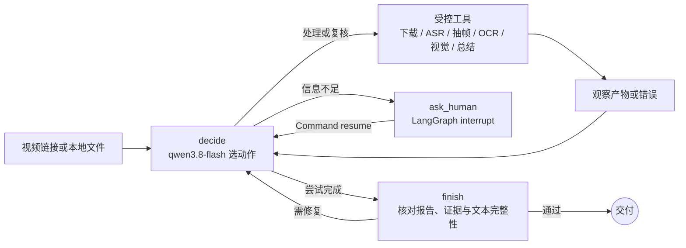
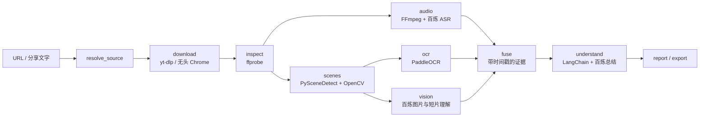

# Video Download Analysis

给一条 B 站、抖音、快手或小红书的视频链接，程序在本地下载视频，提取语音、镜头、画面文字和关键帧，再生成带时间戳与证据 ID 的中文分析报告。项目提供两种运行方式：**Agent Loop** 让百炼模型逐轮选择下一步工具；**Workflow** 按预先定义的 LangGraph 节点图执行。两者共用四平台下载和媒体分析组件。

| | Agent Loop 智能体循环 | Workflow 固定工作流 |
| --- | --- | --- |
| 谁决定下一步 | 百炼 `qwen3.8-flash` 读取当前状态，在受控工具表中选一个动作 | 代码中的图边和依赖决定节点顺序 |
| 遇到信息缺失 | `interrupt()` 提问，SQLite 保存状态；补充后继续 | 以阶段错误结束，修正输入后按检查点续跑 |
| 遇到证据或报告问题 | 可检查证据、补看帧/短片、修复残缺文本，再决定是否完成 | 按节点内预设的审校和修复条件执行 |
| 终止条件 | 报告和证据检查通过，或达到步数/连续反问上限 | 固定图运行到报告节点，或阶段失败 |
| 命令 | `video-review-agent` | `video-review` |

这不是可运行任意命令的开放式 Agent。Agent Loop 的选择范围由代码限定，下载、抽帧、OCR 等单个工具仍按确定的程序执行。

## Agent Loop：模型决定工具调用

[智能体代码](agent_loop/)单独放在 `agent_loop/`，复用原项目已验证的媒体处理函数，不改动 Workflow 的图。每一轮由 [planner.py](agent_loop/planner.py) 调 `qwen3.8-flash` 返回一个结构化动作；[graph.py](agent_loop/graph.py) 执行工具、记录结果，再回到决策节点。



工具有明确前置产物：`resolve_source → download → probe` 后，Agent 可安排 `transcribe`、`sample_frames`、`read_screen_text`、`describe_visuals`，再调用 `fuse_evidence → write_analysis → write_report → finish`。如果证据不足，还能调用 `inspect_evidence`、`review_frame` 或 `review_clip`；残缺摘要和分段可分别调用 `repair_summary`、`repair_structure`。模型每轮只选一个动作，因此实际顺序可能与示意链不同。[state.py](agent_loop/state.py) 只在检查点中保存路径、决策和少量状态，视频及图片留在运行目录。

需要人提供视频来源或内容线索时，图会中断并保存 SQLite 检查点。相同 `thread-id` 可继续回答；连续三次回答仍不能让任务继续时，图返回 `human_input_exhausted`，不再提出第四个问题。`--max-steps` 则限制总决策轮数。完成节点还核对证据 ID、报告是否对应最新分析，以及摘要和时间轴段落是否写完整。具体逻辑在 [graph.py](agent_loop/graph.py)、[tools.py](agent_loop/tools.py) 和 [quality.py](agent_loop/quality.py)。

### Agent Loop 四平台实测

2026-10-12 用下列四条原始链接分别从零开始运行：重新下载、检查媒体、抽帧、OCR、调用百炼模型并生成报告。每例公开详细处理过程、完整文字报告和 **3 张**截图；原视频与其余帧没有进入仓库。

| 平台与原视频 | 实际下载方式 | 时长 / 镜头 / 证据 | Agent Loop 报告与截图 |
| --- | --- | --- | --- |
| [B站｜学以乱用](https://www.bilibili.com/video/BV1yJaH6DEV1/) | `yt-dlp` | 78.62 秒 / 21 镜头 / 203 条证据 | [详细示例](examples/agent-loop/bilibili/README.md) · [截图](examples/agent-loop/bilibili/frames/middle.jpg) |
| [抖音｜中国人会飞](https://www.douyin.com/video/7684591599804937466) | 无头 Chrome 捕获媒体地址 + `yt-dlp` | 16.85 秒 / 1 镜头 / 35 条证据 | [详细示例](examples/agent-loop/douyin/README.md) · [截图](examples/agent-loop/douyin/frames/middle.jpg) |
| [快手｜哪个状元更有含金量](https://www.kuaishou.com/short-video/3x56qx9f9beqtmm) | 无头 Chrome 捕获媒体地址 + `yt-dlp` | 57.67 秒 / 19 镜头 / 178 条证据 | [详细示例](examples/agent-loop/kuaishou/README.md) · [截图](examples/agent-loop/kuaishou/frames/middle.jpg) |
| [小红书｜酱板鸭反转短剧](https://www.xiaohongshu.com/explore/69e09cb0000000001f0035b3) | `yt-dlp` | 39.40 秒 / 22 镜头 / 67 条证据 | [详细示例](examples/agent-loop/xiaohongshu/README.md) · [截图](examples/agent-loop/xiaohongshu/frames/middle.jpg) |

| B站 | 抖音 | 快手 | 小红书 |
| --- | --- | --- | --- |
|  |  |  |  |

实测暴露出模型偶尔会把摘要或时间轴段落写成半句话。抖音和快手的残缺分段通过 `repair_structure` 补全；小红书先尝试摘要与分段修复，分段修复接口返回空内容后，Agent 强制重新分析，得到完整分段并重新生成报告。修复前的草稿保存在本地运行目录，公开示例采用最终报告。[验证说明](docs/agent-loop-validation.md)记录下载、模型产物、反问测试和质量检查。模型结论仍可能有歧义，报告会列出不确定点，证据 ID 只表示引用可追溯。

### 安装和运行 Agent Loop

需要 Python 3.11–3.13，以及本机安装的 `ffmpeg`、`ffprobe`、`yt-dlp`；无头页面回退还需要 Google Chrome。它们是运行依赖，不随仓库上传。先安装两个本地 Python 包：

```bash
python3.12 -m venv .venv
.venv/bin/python -m pip install -e '.[ocr,browser,dev]'
.venv/bin/python -m pip install -e ./agent_loop --no-deps
```

把 `.env.example` 复制为**本地** `.env`，填写自己的 `DASHSCOPE_API_KEY` 与 `BAILIAN_BASE_URL`。Agent Loop 命令会读取此文件，但不会打印密钥；`.env` 已被 Git 忽略。

```bash
.venv/bin/video-review-agent \
  --input 'https://www.bilibili.com/video/BV1yJaH6DEV1/' \
  --thread-id my-bilibili-run \
  --output-dir agent_loop/runs \
  --result-dir agent_loop/results/my-bilibili-run \
  --no-prompt
```

`--no-prompt` 遇到人工问题时暂停并返回退出码 3；随后以相同 `--thread-id` 和 `--output-dir` 运行 `--resume`，可在终端回答或用 `--answer-file /path/to/answer.txt` 提交本地回答。完成为退出码 0，达到上限或质量条件未满足为 2，其他错误为 1。`--file /path/to/video.mp4` 可处理本地视频。`--seed-workflow-run /path/to/run` 可导入已有 Workflow 产物做复核；它不代表重新下载。更多用法见 [Agent Loop 说明](agent_loop/README.md)。

## Workflow：固定图执行

原有 [workflow.py](douyin_review/workflow.py) 定义十个节点与依赖关系，CLI 为 `video-review`。这里由图决定调用顺序，百炼模型负责内容识别和总结，不负责选择下一个工具。



`inspect` 后音频和镜头分支可并行；`scenes` 后 OCR 与视觉分支可并行，`fuse` 等待三路产物。节点间主要传 JSON 文件路径，原视频、音频块和帧图片留在本地运行目录。SQLite 检查点支持固定图的失败续跑。[sources.py](douyin_review/sources.py) 解析四个平台，[media.py](douyin_review/media.py) 负责下载和 FFmpeg/OpenCV/PySceneDetect，[models.py](douyin_review/models.py) 负责百炼调用，[ocr.py](douyin_review/ocr.py) 在本地识字，[report.py](douyin_review/report.py) 与 [export.py](douyin_review/export.py) 生成交付物。

### Workflow 四平台实测

2026-10-11 的固定工作流结果保留在原位置。每例有详细下载和证据说明，以及 4 张精选关键帧：

| 平台 | Workflow 示例 |
| --- | --- |
| B站 | [学以乱用：报告与截图](examples/bilibili/README.md) |
| 抖音 | [中国人会飞：报告与截图](examples/douyin/README.md) |
| 快手 | [哪个状元更有含金量：报告与截图](examples/kuaishou/README.md) |
| 小红书 | [酱板鸭反转短剧：报告与截图](examples/xiaohongshu/README.md) |

运行固定图时需先在当前 shell 加载 `.env`；该命令不会自动读取文件：

```bash
set -a
source .env
set +a
.venv/bin/video-review \
  --input 'https://www.bilibili.com/video/BV1yJaH6DEV1/' \
  --output-dir "$PWD/runs/my-run" \
  --result-dir "$PWD/results/my-video"
```

`--file` 可跳过下载；保留同一输入和运行目录并加 `--resume` 可续跑。结果目录只有报告、结构化 JSON 和入选关键帧，不含原视频。

## 模型、工具与平台边界

| 组件 | 实际作用 | 用在何处 |
| --- | --- | --- |
| 百炼 `qwen3.8-flash` | 选择 Agent Loop 动作；描述图片/无声短片；生成结构化总结；按需修复残缺文本 | Agent Loop 决策与两种模式的内容理解 |
| 百炼 `qwen-audio-3.0-asr-flash` | 把 FFmpeg 音频块转成带时间戳的文字 | 两种模式的 ASR |
| 百炼 `qwen3.8-max` | 条件触发的跨模态冲突审校 | 两种模式的总结阶段，非每次必用 |
| LangGraph / LangChain | 图、检查点、人工中断；提示词与结构化模型输出 | 两种模式，编排方式不同 |
| `yt-dlp` / Playwright + Chrome | 下载；必要时在无头页面获取真实媒体地址 | 两种模式共用 |
| `ffprobe` / FFmpeg | 检查音视频流、切音频、生成短片 | 两种模式共用 |
| PySceneDetect / OpenCV | 找镜头、抽帧；辅助选关键帧 | 两种模式共用 |
| PaddleOCR | 本地识别字幕和其他画面文字，不调用百炼 | 两种模式共用 |

B站示例直接由 `yt-dlp` 下载；抖音的 `modal_id` 搜索链接先规范化为单条视频；快手示例需要无头 Chrome 回退；小红书临时访问参数只用于本地下载，公开页面地址不带访问令牌。默认不会操作用户前台浏览器。站点规则、Cookie 和媒体地址会变化，四条成功案例不能保证所有链接始终可下载。

## 仓库与安全

`agent_loop/` 和 `douyin_review/` 是两种入口的源代码；`tests/` 与 `agent_loop/tests/` 是离线测试。`examples/agent-loop/`、`examples/<平台>/` 仅有报告和少量关键帧。原视频、完整运行缓存、浏览器配置、SQLite 检查点、日志、密钥以及 `ffmpeg`、`ffprobe`、`yt-dlp` 的本机程序不进入 GitHub。公开截图来自各视频，原视频权益归原作者。

```bash
.venv/bin/python -m pytest -q
```

当前本地测试结果：**34 passed**。仓库还保留早期抖音单平台阶段的[工程架构与运行说明](工程架构与运行说明.md)、[实施方案](抖音视频解析实施方案.md)和[模型资料清单](下载抖音视频的工具.md)；现行四平台行为以本 README 与源码为准。
