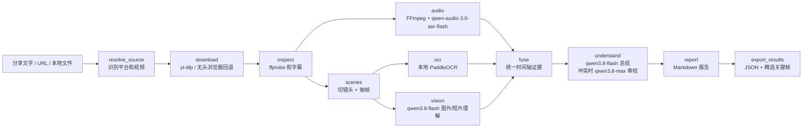

# Video Download Analysis

这是一个由多个 LangGraph 节点组成的本地视频分析工具。给它一条 B站、抖音、快手或小红书的视频链接，它先下载视频，再抽取声音、镜头和关键帧，最后生成带时间戳和证据 ID 的中文报告。节点顺序由代码确定，模型负责识别和理解内容。

## 百炼模型在流程中做什么

下载、切镜头和抽帧由普通程序完成；**语音转写、画面/动作描述和最终内容总结确实调用了阿里云百炼接口**。四条示例视频在本地完整运行时都调用了这些模型，而不只是运行了下载和 OCR。调用代码集中在 [models.py](douyin_review/models.py)，由 [workflow.py](douyin_review/workflow.py) 的节点按依赖关系执行。

| 处理位置 | 模型和调用方式 | 输入与产物 |
| --- | --- | --- |
| `audio` | `qwen-audio-3.0-asr-flash`；`httpx` 调百炼原生语音端点 | FFmpeg 切出的 16 kHz 单声道音频块 → 带原视频时间戳的 ASR 片段。 |
| `vision` 图片分支 | `qwen3.8-flash`；OpenAI 兼容接口 | 每镜头代表帧（最多 6 张一批，必要时补开场帧）→ 人物、物体、场景、可见文字和风格描述。 |
| `vision` 动作分支 | `qwen3.8-flash`；OpenAI 兼容接口的视频输入 | 最多 3 段经过 FFmpeg 缩小且去掉原音频的短片 → 动作、转场和事件顺序描述。 |
| `understand` | `qwen3.8-flash`；LangChain `ChatOpenAI` + Pydantic 结构化输出 | ASR、OCR、视觉描述、片段描述和发布信息汇成的时间轴证据 → 主题、故事、分段、摘要和不确定点。 |
| 条件审校与修复 | 符合跨模态冲突条件时，LangChain 调 `qwen3.8-max`；概述残缺时，OpenAI 兼容接口再调 `qwen3.8-flash` | 只修正被触发的结尾/不确定点或概述；失败时保留初稿并记录状态。 |

凭证由环境变量注入：语音先走工作空间的百炼原生接口；只有该路径返回空的 HTTP 400 时，代码才用同一按量计费 Key 尝试区域原生接口。图片、短片和文本走工作空间的 OpenAI 兼容接口。原视频声音不会交给视频视觉模型，语音与画面证据在后面才汇合。

下表是四条**最终运行产物**中的记录。它说明哪些模型结果真正进入了报告；数字是片段或观察条数，**不是计费 HTTP 请求数**。网络重试、批次拆分和质量修复可能增加请求。

| 示例 | ASR 片段 | 图片观察 | 动作片段 | 文本总结之后的处理 |
| --- | ---: | ---: | ---: | --- |
| [B站](examples/bilibili/README.md) | 13 | 21 | 3 | `qwen3.8-max` 结尾审校已接受 |
| [抖音](examples/douyin/README.md) | 2 | 1 | 3 | `qwen3.8-flash` 概述修复已接受 |
| [快手](examples/kuaishou/README.md) | 23 | 20 | 3 | 保留结构化初稿 |
| [小红书](examples/xiaohongshu/README.md) | 15 | 22 | 3 | `qwen3.8-max` 结尾审校已接受 |

PaddleOCR 是本地识字，不是百炼调用。LangGraph 负责安排节点、并行汇合、重试和续跑；LangChain 用在文本总结与审校的提示词和结构化输出中。模型不会自行决定下载哪个视频或调用哪个工具。

## 已验证的四个平台示例

以下是 2026-10-11 在本地对用户提供的四条链接完成的端到端运行。点击“详细报告”可查看下载路径、每步处理方式、时间轴证据、内容分析和精选画面。站点访问规则会变化，四个成功样本不等于同平台所有链接都可下载。

| 平台与视频 | 实测下载方式 | 时长 | 分析结果 |
| --- | --- | ---: | --- |
| **[B站｜学以乱用](examples/bilibili/README.md)** | yt-dlp 直接下载 | 78.6 秒 | [详细报告](examples/bilibili/README.md) · [关键帧](examples/bilibili/frames/office-box.jpg) |
| **[抖音｜中国人会飞](examples/douyin/README.md)** | 无头 Chrome 获取媒体地址，再由 yt-dlp 下载 | 16.9 秒 | [详细报告](examples/douyin/README.md) · [关键帧](examples/douyin/frames/flip-one.jpg) |
| **[快手｜哪个状元更有含金量](examples/kuaishou/README.md)** | 无头 Chrome 获取媒体地址，再由 yt-dlp 下载 | 57.7 秒 | [详细报告](examples/kuaishou/README.md) · [关键帧](examples/kuaishou/frames/comparison.jpg) |
| **[小红书｜酱板鸭反转短剧](examples/xiaohongshu/README.md)** | yt-dlp 直接下载 | 39.4 秒 | [详细报告](examples/xiaohongshu/README.md) · [关键帧](examples/xiaohongshu/frames/cat-reveal.jpg) |

## 工作流如何运行

`video-review` 是单条视频的 CLI 入口。`cli.py` 建立运行目录和 SQLite 检查点；`workflow.py` 定义十个固定节点及依赖。节点之间主要传递 JSON 文件路径，原视频、音频和帧图片留在运行目录，避免把大文件塞进 LangGraph 状态。



`inspect` 后的音频与镜头分支可并行；`scenes` 后的 OCR 与视觉分支可并行。`fuse` 等待三路完成。平台差异集中在链接解析和下载层，后面的媒体分析图对四个平台相同。

| 节点 | 输入 → 输出 | 核心作用 |
| --- | --- | --- |
| `resolve_source` | 分享文字/URL → `source.json` | 找到唯一受支持的链接，规范化公开地址；下载所需的临时参数仅留在内部数据。 |
| `download` | 视频地址 → `media.json`、原视频 | 首先尝试 yt-dlp；失败后按平台尝试 Chrome Cookie 或无头页面媒体地址。 |
| `inspect` | 原视频 → `probe.json` | ffprobe 确认时长、音视频流、分辨率及字幕；FFmpeg 导出可用字幕轨。 |
| `audio` | 音轨 → `asr.json` | FFmpeg 转 16 kHz 单声道 MP3，最多约 180 秒一块、相邻重叠 1 秒；调用 `qwen-audio-3.0-asr-flash`，把块内时间换算回原视频毫秒。 |
| `scenes` | 视频 → `scenes.json`、抽帧 | PySceneDetect 找镜头边界；OpenCV 保存镜头候选帧和约每 500 毫秒一张的 OCR 采样帧。 |
| `ocr` | 采样帧/字幕 → `ocr.json` | PaddleOCR 本地识字，合并时间相邻的重复文字；独立解析 SRT。 |
| `vision` | 候选帧/动作片段 → `visual.json` | 每镜头选代表帧，必要时补看开场帧；调用 `qwen3.8-flash` 分批描述图片，并用同一模型检查最多 3 段短片的动作和转场。 |
| `fuse` | ASR/OCR/视觉/发布信息 → `evidence.json` | 给不同来源附加统一的毫秒时间轴和证据 ID；按质量、文字关联和感知哈希选最多 24 张不重复关键帧。 |
| `understand` | 时间轴证据 → `analysis.json` | LangChain 调 `qwen3.8-flash` 生成主题、故事、分段结构、摘要和不确定项；核对证据 ID，有跨模态冲突时尝试 `qwen3.8-max` 审校。 |
| `report` | 结构化分析 → `report.md` | 生成可阅读的时间轴报告。图结束后，CLI 再导出可移动的结果目录。 |

### 为什么图片和动作要分别分析？

单张高质量帧能说明人物、场景、字幕和构图，却可能漏掉侧手翻、转场等连续事件。`vision` 因此还会比较候选帧的感知哈希，为有明显变化的镜头选短视频片段；超过 10 秒的连续镜头会切成约 4.5 秒的窗口。抖音示例最初只有一个约 17 秒的镜头，单帧分析漏掉翻转动作；补充动作片段后才识别出侧手翻。快手示例则需要额外看开场帧，才能确认“体考状元”和“高考749分”是左右并列的对照标签。

视觉模型接收的短片**不含原音频**。声音由 ASR 单独处理，屏幕文字由 OCR 单独处理。它们在 `fuse` 中仍保留各自来源，避免把画面推断当作台词。

### 证据与所用组件

一条证据至少包含 `id`、`source`、`start_ms`、`end_ms` 和 `text`。例如 `asr_...` 是语音，`ocr_...` 是画面文字，`visual_...` 是静态画面描述，`clip_...` 是动作片段描述；最终结构段引用这些 ID。完整原始证据留在内部 JSON，送给总结模型的是去掉图片绝对路径和 OCR 坐标后的紧凑版本。

- **编排与输出**：LangGraph `StateGraph`、SQLite checkpointer、LangChain `ChatOpenAI`、Pydantic。
- **媒体与图像**：yt-dlp、Playwright/Google Chrome、FFmpeg/ffprobe、PySceneDetect、OpenCV、Pillow/ImageHash、PaddleOCR。
- **百炼模型**：`qwen-audio-3.0-asr-flash` 转写；`qwen3.8-flash` 描述图片/短片并总结；`qwen3.8-max` 只在符合条件的跨模态冲突时尝试审校。模型调用需要按量计费凭证。

`understand` 会过滤不存在的证据 ID，并拒绝或标记明显残缺的模型输出。证据 ID 证明“引用存在”，不能自动证明“结论必然正确”；详细报告仍列出不确定点，适合人工复核。

## 四个平台如何下载

- **B站**：识别 `/video/BV.../` 或 `av...`，示例由 yt-dlp 直接下载。
- **抖音**：标准视频链接、`modal_id` 精选搜索链接和 `v.douyin.com` 短链会规范化为单条视频 URL。示例直连受限，程序在无头 Chrome 中读取播放器媒体地址，立即交给 yt-dlp 下载。
- **快手**：`/short-video/<ID>` 链接先尝试 yt-dlp；当前环境不支持该页面提取，程序通过无头 Chrome 获取播放器地址并有限重试，再用 yt-dlp 保存。默认不会操作用户前台浏览器。
- **小红书**：`/explore/<ID>` 与 `/discovery/item/<ID>` 由 yt-dlp 处理。某些分享链接带临时访问参数；程序在内部保留下载参数，公开报告使用不含这些参数的页面地址。

下载方式依赖站点当时的公开可访问页面、登录状态和媒体地址有效期。需要人工完成登录或验证时，使用者可以**主动**传入 `--interactive-browser`；默认调用始终使用无头浏览器。

## 本地安装与运行

需要 Python 3.11–3.13、`ffmpeg`、`ffprobe`、`yt-dlp` 和网络。浏览器回退还需要本机 Google Chrome；OCR 与浏览器依赖在安装时选择：

```bash
python3.12 -m venv .venv
.venv/bin/python -m pip install -e '.[ocr,browser,dev]'
```

复制 `.env.example` 为本地 `.env`，填入**自己的**阿里云百炼按量计费 Key 和工作空间兼容接口地址。`.env` 已被忽略；程序不会自动加载它，可在当前 shell 中加载：

```bash
set -a
source .env
set +a

.venv/bin/video-review \
  --input 'https://www.bilibili.com/video/BV1yJaH6DEV1/' \
  --output-dir "$PWD/runs/my-run" \
  --result-dir "$PWD/results/my-video"
```

`--input` 也接受一整段包含唯一受支持链接的分享文字。`--file /path/to/video.mp4` 可跳过下载分析本地视频。旧命令 `douyin-review` 仍可用。`video-review-preflight` 会调用小样本付费模型接口，仅在需要检查凭证/模型权限时使用。

`runs/<输入哈希>/` 保存原视频和各阶段产物；`--output-dir` 根目录保存 `checkpoints.sqlite`。`--result-dir` 中只有报告、完整结构化 JSON 和入选关键帧，不含原视频。失败续跑时，保留同一输入与 `--output-dir`，加 `--resume`。结果目录必须为空或不存在，避免覆盖其他视频。

## 仓库内容与边界

`douyin_review/` 是历史沿用的 Python 包名，公开 CLI 名称已改为 `video-review`。关键代码：`sources.py` 负责四平台链接，`media.py` 负责下载和媒体处理，`workflow.py` 负责图节点，`models.py` 负责百炼适配，`ocr.py` 负责本地识字，`report.py`/`export.py` 负责交付。`tests/` 包含离线测试。

`examples/` 仅保存四份经过整理的报告和每例 4 张关键帧。原始视频、完整运行缓存、浏览器配置、日志、密钥和其他本地结果均不进入 GitHub。示例图片取自各自链接的视频，原视频权益归原作者。分析报告是模型辅助生成的复核材料，尤其对人物身份、拍摄设备、画面外事件和语音/OCR 冲突应保持来源区分。

当前测试使用 `.venv/bin/python -m pytest -q`，本地结果为 **22 passed**。

## 历史设计记录

仓库还保留了早期抖音单平台阶段的[工程架构与运行说明](工程架构与运行说明.md)、[实施方案](抖音视频解析实施方案.md)和[模型资料清单](下载抖音视频的工具.md)。这些文档已移除真实密钥、专属工作空间地址和本机绝对路径；它们用于追溯设计过程，四平台现行行为以上面的说明和当前源码为准。
