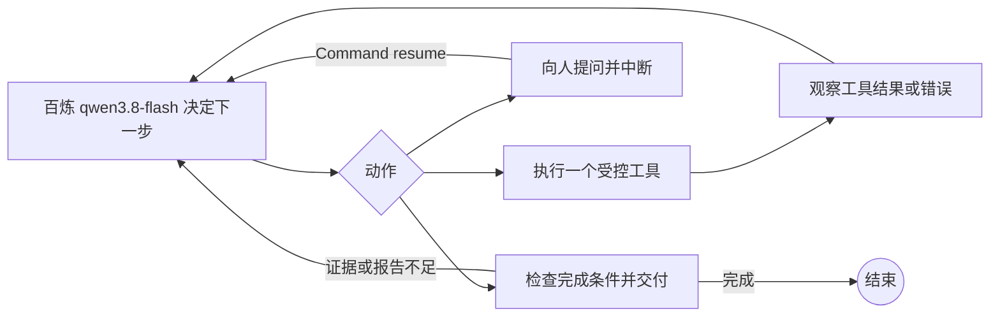

# 视频分析 Agent Loop

这是与现有固定工作流并列的**独立代码包**，保存在 `agent_loop/`。它复用 `douyin_review/` 已验证的下载、FFmpeg、OCR 和百炼适配器；原有工作流源码与 `video-review` 命令保持原样。源码和少量示例截图进入仓库，下载视频与完整运行产物留在本地。

## 与固定工作流的区别

固定工作流的边是预先写好的。这里的 LangGraph 只规定一个循环外壳：



模型每轮只从**封闭的工具列表**选择一个动作。它可以根据错误改选工具、要求人工提供链接或线索、补看具体时间点或 4–10 秒短片，并在新增证据后重新总结。模型不能运行任意 shell 命令，也不能自行指定任意本地文件进行读取。单个工具的媒体处理仍是确定性的；自主性体现在**选择、检查和再次选择**。

可选动作包括：导入已有运行产物、解析链接、下载、ffprobe 检查、ASR、抽帧、OCR、视觉描述、证据汇合、结构化总结、修复未完成摘要或分段、报告生成、证据检查、补看一帧、补看一段、询问人和完成。工具的缺失前提会作为错误反馈给模型，最多执行 `--max-steps` 轮。完成节点会核对报告、最新分析、摘要和时间轴分段的完整性以及证据 ID，不能仅靠模型声称“已完成”。

## 人在循环中补充信息

模型选择 `ask_human` 时，LangGraph 的 `interrupt()` 会把问题及当前图状态写入独立 SQLite 检查点。终端有交互能力时可直接回答；非交互模式会打印运行 ID 后暂停。之后使用**同一运行 ID**并通过 `Command(resume=...)` 继续：

连续三次人工补充仍无法让任务继续时，图会拒绝第四次提问，以 `human_input_exhausted` 结束该运行（退出码 2）。成功执行一个推进任务的工具后，反问计数清零；无效链接导致的工具错误不会清零。此时请提供完整输入并新建运行，避免无限循环。

非交互模式暂停等待人工回答时，命令返回退出码 **3**；步数上限为 **2**，其他运行错误为 **1**，完成为 **0**。因此自动化脚本不会把“等待人工”误判成已成功交付。

```bash
video-review-agent --input '一段信息不完整的分享文字' \
  --thread-id my-video --no-prompt

# 稍后在交互终端运行；程序会显示待回答的问题
video-review-agent --resume --thread-id my-video
```

无法在终端交互时，也可以把回答保存在本地 UTF-8 文件，再运行 `video-review-agent --resume --thread-id my-video --answer-file /path/to/answer.txt`。回答文件应放在被忽略的本地目录，不要加入版本库。

人工可以补充可访问的视频地址、本地文件路径，或标明来源的内容观察。人工观察作为 `human_note` 单独记录，不覆盖 ASR、OCR 或视觉原始证据。补看帧/短片和人工观察会使已有总结标记为过期，必须再次调用 `write_analysis` 和 `write_report` 才能完成。
智能体主动补看的单帧会作为新的证据和关键帧进入重新生成的报告；补看的短片保留独立的 `agent_clip_...` 证据 ID。

## 安装与运行

先在项目根目录安装原项目，再安装本独立包：

```bash
.venv/bin/python -m pip install -e '.[ocr,browser]'
.venv/bin/python -m pip install -e ./agent_loop --no-deps
```

新命令为 `video-review-agent`；也可以在项目根目录运行 `.venv/bin/python -m agent_loop`。它会从项目根目录被忽略的 `.env` 读取 `DASHSCOPE_API_KEY` 和 `BAILIAN_BASE_URL`，不会打印密钥。默认使用后台无头 Chrome，只有明确给出 `--interactive-browser` 才会打开可见浏览器。

```bash
.venv/bin/video-review-agent \
  --input 'https://www.bilibili.com/video/BV1yJaH6DEV1/' \
  --thread-id my-bilibili-video \
  --output-dir agent_loop/runs \
  --result-dir agent_loop/results/my-bilibili-video
```

也支持 `--file /path/to/local.mp4`。每次运行的下载视频、抽帧、检查点和 JSON 都在本地 `agent_loop/runs/`；交付目录在 `agent_loop/results/`。这两个目录被项目的 `.gitignore` 排除。

### 从已有固定工作流结果开始

如果固定工作流或之前的 Agent Loop 已处理完同一条视频，可以用 `--seed-workflow-run` 导入兼容的运行目录。导入时会验证并复制原视频、音频块、候选帧、OCR 图片与阶段 JSON 到新的本地运行目录，再由模型决定是否检查或补充证据；这种复核不重新下载视频。

```bash
.venv/bin/video-review-agent \
  --seed-workflow-run runs/four-platform-20261011/a9b427e2f288fc27 \
  --thread-id bilibili-agent-example \
  --result-dir agent_loop/results/bilibili-agent-example
```

本地已对之前的 B站、抖音、快手、小红书四条运行产物执行这种导入验证。B站、快手和小红书由决策模型选择导入后完成；抖音选择先检查证据再完成。导入模式检验循环、检查点、交付和四平台产物兼容性；从全新链接开始仍会逐步调用下载、OCR 和百炼模型。

另用一段本地 4 秒红蓝色块视频进行了**从零开始的真实百炼决策运行**：模型依次选择来源解析、文件复制、媒体检查、ASR、抽帧、本地 OCR、视觉描述、证据汇合、总结、报告和完成。该测试音只有纯音调，ASR 正确给出 0 条语音片段。当前整个项目本地测试为 **34 passed**。

2026-10-12 的四平台原始链接全新下载验证，验证记录在本地 `agent_loop/validation/2026-10-12/`，完整视频在 `agent_loop/runs/`；经过整理的报告和每条 3 张截图见[公开示例](../examples/agent-loop/)。首次报告出现过半句摘要和分段：抖音、快手的分段由 `repair_structure` 补全；小红书在定向修复调用失败后强制重新分析并完成交付。修复前草稿保留在本地。验证还覆盖了“提示词没有视频来源，连续三次补充仍无效”时的退出行为。

## 调用边界

- 决策节点调用 `qwen3.8-flash`。真正转写、画面/动作描述和总结时，沿用原项目的百炼模型适配器；每轮决策本身也会产生按量计费请求。
- `review_frame` 与 `review_clip` 是**额外的付费视觉调用**，只有模型认为现有证据不足时才应选择。结果保留独立证据 ID。
- 无头页面访问可能要求有效 Cookie；无法自动取得的视频应请人提供可访问链接或本地文件。程序不会自行绕过人工验证。
- 原视频与密钥始终留在本地。CLI 本身没有发布、上传或 GitHub 推送动作。
