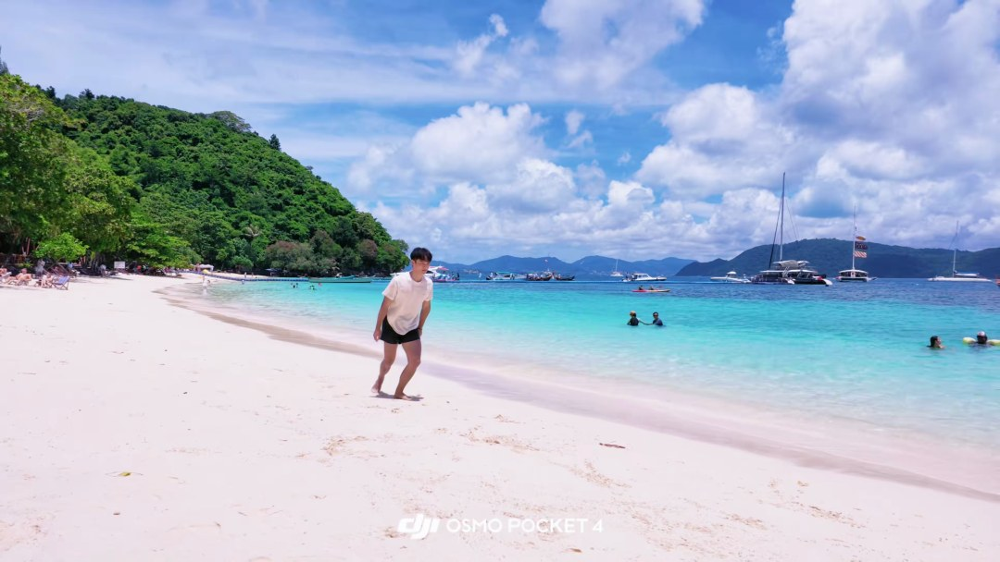
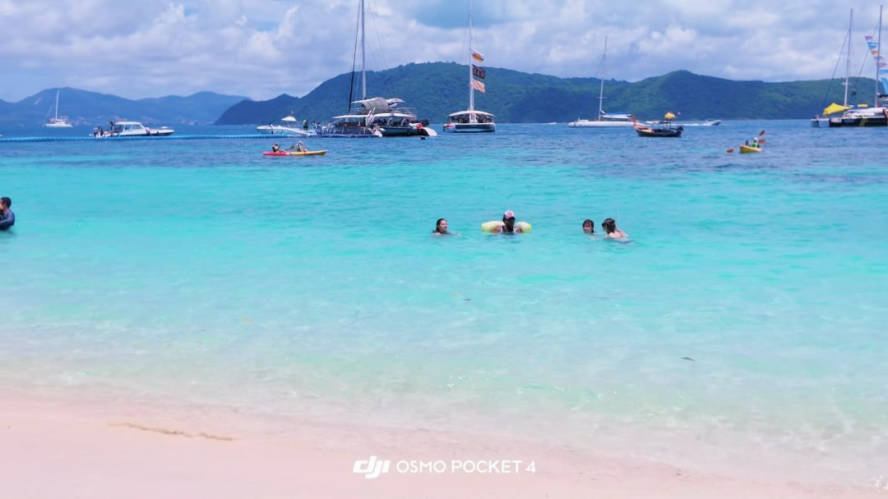

# 视频解析报告

- 平台：douyin
- 视频：https://www.douyin.com/video/7684591599804937466
- 时长：00:16
- 标题：中国人会飞哈哈哈哈哈 外国小姐姐在给我们鼓掌👏 你看到了👉🌊🌊 #翻身极限特技 #深圳空翻#中国人会飞 #海边飞起来 #深圳毯功技巧

## 内容理解

**主题：** 海滩空翻炫技与反复高喊口号

**故事或观点：** 视频记录了几名年轻男子在热带白沙滩上依次表演侧手翻动作，画外音反复高喊“中国人能飞”。

**摘要：** 视频拍摄于热带白沙滩，画面中多名年轻男子依次表演侧手翻（空翻）动作，背景为碧蓝海水、停泊的游艇帆船与绿色山丘。画外音从约1.2秒起反复高喊“中国人能飞”。

## 视频结构

- **00:00–00:01｜开场：** 画面以广角镜头展示热带海滩全景：白色沙滩、碧蓝海水、远处游艇与帆船、绿色山丘与蓝天白云。一名穿白色T恤黑色短裤的男子站在沙滩上面朝镜头，画面底部持续显示白色“DJI OSMO POCKET 4”字样。（证据：visual_scene_000_0, ocr_0000）
- **00:01–00:06｜第一轮空翻：** 白衣男子背对镜头完成侧手翻，随后镜头转向沙滩另一侧，另一名穿浅绿色长袖上衣的男子也完成侧手翻。画外音开始反复喊“中国人能飞”。（证据：clip_1731_6231, asr_000_0000）
- **00:06–00:12｜第二轮空翻：** 一名穿浅灰色长袖上衣、深色短裤的男子在镜头前完成侧手翻：起势、腾空倒置、落地站稳。背景仍为碧蓝海水与停泊船只，画面下方持续显示设备水印。（证据：clip_7750_12250, visual_scene_000_3）
- **00:12–00:16｜收尾：** 灰衣男子面带笑容朝镜头走来后出画，镜头转向开阔海面，可见游泳者和涉水者。画外音继续喊“中国人能飞”。（证据：clip_12350_16850, asr_000_0001）

## 画面场景与视觉风格

- [00:00] 这是一张广角镜头拍摄的海滩风景照片。画面中心偏左位置，一名身穿白色短袖T恤和黑色短裤的年轻男子站在白色沙滩上，面朝镜头。他的身后是清澈的蓝绿色海水，海水中散布着几艘白色的游艇和帆船，远处有连绵的青山。天空湛蓝，漂浮着大片的白云。沙滩左侧有一片茂密的绿色树林，树林边缘隐约可见一些游客和遮阳伞。画面底部中央有白色的“dji OSMO POCKET 4”字样。整体画面明亮，色彩饱和度高，呈现出热带度假的氛围。；风格：明亮、高饱和度、广角、风景摄影、旅行记录（visual_scene_000_0）
- [00:04] 海滩上有两名男子，左侧男子穿浅蓝色长袖上衣，右腿抬起，身体微倾；右侧男子穿浅灰色长袖衬衫和深绿色短裤，站立面向镜头。背景为茂密绿树、白色沙滩、碧蓝海水及远处山丘。画面底部中央有白色文字“DJI OSMO POCKET 4”。；风格：自然光实拍，清晰明亮，色彩饱和度高（visual_scene_000_3）

## 动作与转场

- [00:12–00:16] 这段视频拍摄于一个热带海滩，海水呈清澈的蓝绿色，远处停泊着多艘游艇和帆船，背景是绿色山丘与蓝天白云。画面带有“DJI OSMO POCKET 4”水印。  **动作与事件顺序：**  1. **开头（约0–1秒）：** 一名穿浅灰色长袖上衣、深色短裤的年轻男子从画面中央朝镜头走来，脸上带着笑容。画面右侧，另一名穿白色T恤的男子正沿着水边行走。 2. **中段（约1–2秒）：** 灰衣男子走近镜头并从画面右侧经过，此时镜头中可以看到海里已有几名游泳者（其中一人旁边有黄色浮具）。白衣男子继续向浅水区走去。 3. **后段（约2–4秒）：** 灰衣男子完全走出画面，镜头视野转向开阔的海面：几名游泳者漂浮在水中，白衣男子在右侧浅水里涉水而行，远处是停泊的船只和海岛。  **镜头变化：**  - 镜头为手持/稳定器拍摄，起始时以走近的男子为主体，机位较低，接近沙滩水面。 - 随着男子从右前方经过并出画，镜头平滑地向左摇移（或主体右移使画面重心左移），构图从人物近景过渡到海滩与海面的全景。 - 结尾画面稳定在海景上，人物（游泳者与涉水者）成为环境中的点缀，突出碧蓝海水、白色沙滩与远处船只的度假氛围。  整个过程没有明显的推拉变焦，主要通过人物走位和镜头摇移完成从“人物特写”到“环境全景”的转换。（clip_12350_16850）
- [00:01–00:06] **动作与事件顺序：**  - **0–1秒**：一名穿白色T恤、黑色短裤的男子在白色沙滩上背对镜头做侧手翻。他先抬起双臂、身体侧倾，腾空时身体近乎水平、双腿张开，随后双手落地、弯腰完成翻转，双脚分开站稳。背景是蓝天白云、碧蓝海水、停泊的帆船，海中有零星游泳的人。 - **约2秒**：镜头转向沙滩的另一侧——画面左侧是茂密的绿树，远处为绿色山丘，海面移至画面右侧。刚才翻完的白衣男子正面站立在沙地上，另一名穿浅绿色长袖上衣、牛仔短裤的男子蹲在画面左缘，呈准备姿势。 - **3–4秒**：浅绿衣男子向前迈步并完成一个侧手翻：身体侧倾、双臂展开、一条腿高高抬起；翻转结束落地时弯腰、双手撑地，腿部仍带惯性上扬。白衣男子此时站在画面左缘观看。  **镜头变化：**  - 全程为广角全景镜头，底部持续显示“DJI OSMO POCKET 4”水印。 - 开头镜头固定在白衣男子身后，记录其翻转；约2秒处镜头向左摇转（改变拍摄方向约180度），从面向大海转为面向树丛与山丘；之后再次固定，记录第二人的侧手翻。（clip_1731_6231）
- [00:07–00:12] **场景概述**：热带白沙滩上，一名穿浅灰色长袖上衣、深色短裤的男子在镜头前做翻滚动作。背景是碧蓝海水、停泊的帆船和游艇、左侧的绿色山丘与蓝天白云，画面下方始终带有"DJI OSMO POCKET 4"水印。  **动作与事件顺序**： 1. **0秒**：男子双脚分开站立，膝盖微屈，一臂上举、一臂侧伸，身体向侧方倾斜，呈起势准备姿势。 2. **1秒**：他侧身翻起，双手接近沙地，身体倒置、双腿在空中前后分开，完成一个侧手翻（空中旋转）动作。 3. **2秒**：旋转继续，双脚回落地面，躯干仍在扭转，一只手触地缓冲，处于落地收尾阶段。 4. **3秒**：男子完全站直，面向镜头，身体略微前倾、双臂下垂，动作结束。 5. **4秒**：男子蹲伏在海水边缘，一只手撑在湿沙上，似乎刚完成动作或准备下一个动作；此时画面构图已明显偏向海面，可见远处游泳的人和更多船只。  **镜头变化**：前段为低机位广角固定跟拍，主体基本保持在画面中左部，背景稳定；到最后一秒镜头向右摇移（或机位转向海面方向），使男子被移到画面左边缘，海景和船只占据画面主体，完成从"人物动作"到"环境氛围"的构图过渡。（clip_7750_12250）

## 公开的关键帧

完整运行选出的其他关键帧和原视频保存在本地，此处只展示三张截图。

### 00:00

### 00:08

### 00:16

## 完整语音转写

- [00:01–00:09] 中国人能飞，中国人能飞，中国人能飞，中国人能（asr_000_0000）
- [00:11–00:16] 飞，中国人能飞，中国人能飞，（asr_000_0001）

## 画面文字与字幕

- [00:00–00:00] OSMO POCKET 4（ocr_0000）
- [00:00–00:01] IOSMOPOCKET4（ocr_0001）
- [00:01–00:02] OSMO POCKET 4（ocr_0002）
- [00:02–00:02] JI OSMO POCKET4（ocr_0003）
- [00:02–00:04] I OSMO POCKET 4（ocr_0004）
- [00:04–00:04] JFOSMOPOCKET（ocr_0005）
- [00:04–00:05] EJFOSMOPOCKET4（ocr_0006）
- [00:05–00:05] IJIOSMO POCKETA（ocr_0007）
- [00:05–00:06] OSMO POCKET 4（ocr_0008）
- [00:06–00:06] IOSMOPOCKET4（ocr_0009）
- [00:06–00:07] OSMO POCKET 4（ocr_0010）
- [00:07–00:07] IOSMO POCKET 4（ocr_0011）
- [00:07–00:08] OSMO POCKET 4（ocr_0012）
- [00:08–00:09] JIOSMO POCKET 4（ocr_0013）
- [00:09–00:09] OSMO POCKET 4（ocr_0014）
- [00:09–00:10] IOSMO POCKET 4（ocr_0015）
- [00:10–00:10] dI OSMO POCKET 4（ocr_0016）
- [00:10–00:11] I OSMO POCKET 4（ocr_0017）
- [00:11–00:12] OSMO POCKET 4（ocr_0018）
- [00:11–00:12] d（ocr_0019）
- [00:12–00:13] POSMO POCKET 4（ocr_0020）
- [00:13–00:13] OSMO POCKET 4（ocr_0021）
- [00:13–00:14] JIOSMOPOCKET4（ocr_0022）
- [00:14–00:16] OSMOPOCKET4（ocr_0023）
- [00:16–00:16] IOSMO POCKET 4（ocr_0024）
- [00:16–00:17] OSMO POCKET 4（ocr_0025）

## 不确定信息

- 无法从画面证据确认该视频为单次连续拍摄还是多段拼接。
- 模型返回了一条未完成的不确定项；已剔除该片段，请结合原始证据人工复核。
