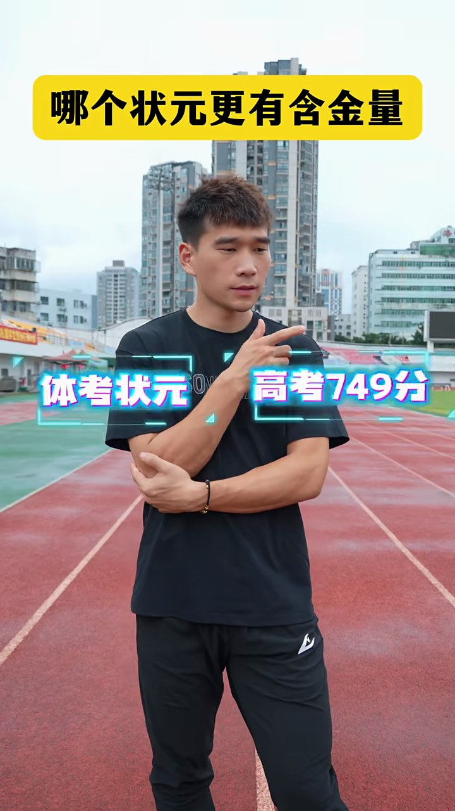
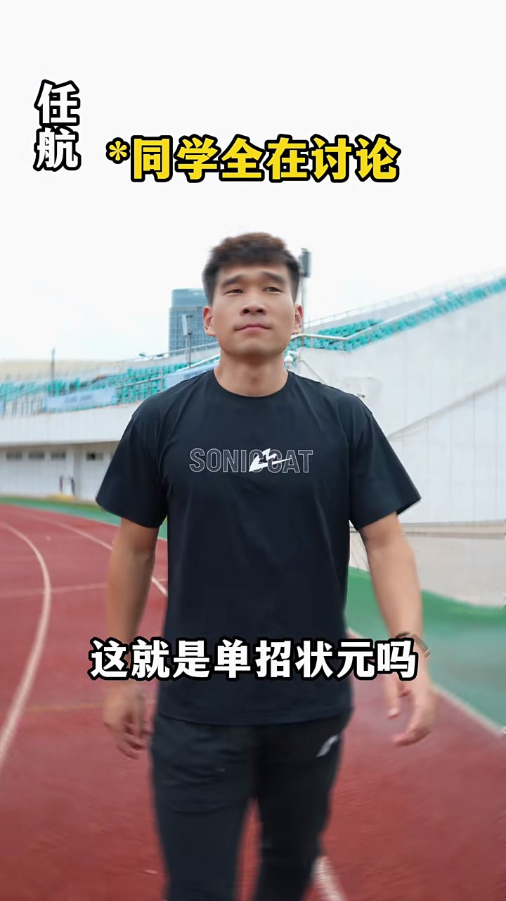

# 视频解析报告

- 平台：kuaishou
- 视频：https://www.kuaishou.com/short-video/3x56qx9f9beqtmm
- 时长：00:57
- 标题：大家认为哪个状元更有含金量 #北体航航 #体育生 #田径-快手

## 内容理解

**主题：** 以'哪个状元更有含金量'为主题的搞笑短剧，通过夸张对比'体考状元'（体育单招状元）与'高考状元'的待遇差异制造笑点。

**故事或观点：** 视频虚构了一位名为'任航'的体育生武状元（全国第一），他获得学校10万元奖金、同学追捧签名合影、体育大学免学费保研邀请、品牌方全包装备，最后父母来电告知'店长要把女儿介绍给他'，他立刻说'我马上到'。全片以荒诞升级的'被争抢'情节讽刺体育单招状元在现实中的高待遇，同时通过开头'体考状元'与'高考749分'的并列标签引发对比讨论。

**摘要：** 这是一条约57秒的快手搞笑短剧，主角'任航'被设定为全国第一的体育单招状元（'武状元'）。视频以'哪个状元更有含金量'为引子，将'体考状元'与'高考749分'并列展示。剧情中任航依次获得：校长批的10万元奖金、同学追捧签名合影、体育大学免学费保研邀请、品牌方全包训练装备，最后父母来电告知店长要把女儿介绍给他，他立刻说'我马上到'。全片通过层层加码的荒诞待遇制造喜剧效果，以讽刺夸张的方式呈现体育单招状元被各方争抢的虚构场景。

## 视频结构

- **00:00–00:05｜开场设问与对比：** 画面展示一名年轻男子站在跑道上，两侧分别标注'体考状元'和'高考749分'，顶部文字'哪个状元更有含金量'点明主题。随后硬切至该男子走在红地毯上，背景为'体育生武状元'红色拱门，左上角标注'任航'。（证据：visual_scene_000_0, visual_scene_000_3, ocr_0000, ocr_0007, ocr_0011, ocr_0014）
- **00:05–00:22｜校长对话——奖金与志愿：** '教练'角色通知任航校长找他。'校长'（戴灰白假发）告知已批10万元奖金送到家中，并建议报清北。任航表示还没想好志愿，校长说学校还没出过清北，任航回应'我考虑一下吧'。（证据：asr_000_0001, asr_000_0003, asr_000_0005, asr_000_0007, asr_000_0008, visual_scene_001_0, visual_scene_003_2, visual_scene_005_1, visual_scene_007_0）
- **00:22–00:31｜同学追捧与签名合影：** 任航在跑道上行走，字幕'*同学全在讨论'，有人喊'这就是单招状元吗？太帅了！这可是全国第一呀！'。'刘梦'角色上前请求签名合影，任航答应，字幕'*暗爽至极'。随后出现领奖台场景，周围学生鼓掌欢呼。（证据：asr_000_0009, asr_000_0010, asr_000_0011, asr_000_0012, asr_000_0013, clip_22233_26867, visual_scene_011_1, visual_scene_012_1, visual_scene_013_2）
- **00:31–00:42｜体育大学来电——免学费保研：** 任航接电话，字幕'*体育大学致电'，对方表示让他报体育大学，学费全免还保研。任航再次说'我考虑一下吧'。（证据：asr_000_0015, asr_000_0016, visual_scene_014_1, clip_40933_50200, ocr_0086）
- **00:42–00:51｜品牌方递红包——全包装备：** “体育品牌”角色出场，递红包给任航，称“航哥你好，小小心意你先收下”，并表示品牌方非常有诚意，承诺以后所有的训练装备、训练鞋、训练衣服，包括背包、袜子全部给任航包了。任航回应“这也太爽了吧”。（证据：asr_000_0017, asr_000_0018, asr_000_0019, clip_40933_50200, visual_scene_016_0）
- **00:51–00:57｜父母来电——店长介绍女儿：** 字幕'*父母打来电话'，父母问'孩子你啥时候回家呀'，并告知'店长也来了，说把他女儿介绍给你'。任航惊讶说'啊？'随即立刻回答'我马上到'。（证据：asr_000_0020, asr_000_0021, asr_000_0022, asr_000_0023, clip_51333_57300, visual_scene_017_0）
- **00:57–00:57｜结尾测试卡：** 画面切换为彩色条纹测试卡，视频结束。（证据：visual_scene_018_1）

## 画面场景与视觉风格

- [00:00] 一名年轻男子站在红色塑胶跑道上，身穿黑色短袖T恤和黑色运动裤。他右手横抱在腹部，左手臂抬起，食指指向左上方。男子身后是城市高楼和体育场看台。画面顶部有一个黄色矩形背景框，男子身体两侧分别有带科技感边框的文字。；风格：现代运动风，带有短视频字幕特效（visual_scene_000_0）
- [00:03] 画面中央是一名年轻男子，正沿着红地毯向镜头方向走来。他身穿黑色短袖T恤和黑色长裤，T恤胸前印有“SONICCAT”字样。他的身后是一个巨大的红色充气拱门，拱门上写有金色的“体育生武状元”五个大字。背景是一栋红砖教学楼，楼前挂有彩旗，两侧立柱上有对联，左联隐约可见“...进...学...”，右联隐约可见“...录...不...”。左上角有黑色文字“任航”。画面整体色彩鲜艳，红、黄、黑为主色调，具有强烈的仪式感和喜庆氛围。；风格：鲜艳、喜庆、仪式感（visual_scene_000_3）
- [00:05] 画面主体为一名身穿白色连帽运动外套的男子，他正对着镜头说话，表情略显惊讶或激动。他的头发是黑色的，刘海较长。背景是室外运动场，可以看到远处的城市高楼、绿色的草坪和红色的跑道。左上角有红色文字“教练”。画面下方有白色字幕“武状元你终于来了”。；风格：写实、日常（visual_scene_001_0）
- [00:07] 与第一帧场景相同，画面中央的年轻男子站在红地毯上，位于“体育生武状元”的红色拱门下方。他身穿黑色T恤，表情略带疑惑地看向一侧。左上角有黑色文字“任航”。画面下方有白色字幕“校长找我什么事”。背景是红砖教学楼和彩旗。；风格：鲜艳、喜庆、仪式感（visual_scene_002_0）
- [00:12] 画面主体为一名男子，他戴着一顶灰白色的假发，身穿黑色运动外套，表情严肃地对着镜头说话，并抬起右手食指指向上方。背景是室外运动场，有绿色的草坪和远处的看台。左上角有黄色文字“校长”。画面下方有白色字幕“已经送到你家里了”。；风格：写实、日常（visual_scene_003_2）
- [00:14] 画面主体为第一帧中的年轻男子，他身穿黑色T恤，站在室外运动场上，背景是绿色的草坪、红色的跑道和远处的城市建筑。他看向一侧，表情平静。左上角有黑色文字“任航”。画面下方有白色字幕“感谢学校的栽培”。；风格：写实、日常（visual_scene_004_2）
- [00:16] 与第四帧场景相同，画面主体为戴着灰白色假发、身穿黑色运动外套的男子。他双手交握于身前，表情认真地对着镜头说话。背景是室外运动场。左上角有黄色文字“校长”。画面下方有白色字幕“想好报哪了吗”。；风格：写实、日常（visual_scene_005_1）
- [00:17] 一名年轻男子站在户外跑道上，身穿黑色短袖T恤，胸前印有白色“SONICCAT”字样。他双手叉腰，表情略显无奈或思考。背景是体育场看台和远处的建筑。左上角有“任航”字样，下方有字幕“我还没想好呢校长”。；风格：写实风格，户外运动场景（visual_scene_006_0）
- [00:19] 一名男子站在户外跑道上，戴着灰白色的假发，身穿黑色连帽外套。他双手在胸前交握，表情严肃。背景是体育场和远处的建筑。左上角有黄色“校长”字样，下方有字幕“填清北吧”。；风格：写实风格，角色扮演（visual_scene_007_0）
- [00:20] 同一名戴灰白假发、穿黑色连帽外套的男子。他左手抬起指向自己的肩膀，嘴巴微张，似乎在说话。左上角有黄色“校长”字样，旁边有白色“*有面”字样，下方有字幕“咱们学校还没”。；风格：写实风格，角色扮演（visual_scene_008_0）
- [00:22] 画面切回第一名年轻男子，身穿黑色短袖T恤。他双臂自然下垂，眼神看向侧前方，表情有些迟疑。左上角有“任航”字样，下方有字幕“呃我考虑一下吧”。；风格：写实风格，户外运动场景（visual_scene_009_0）
- [00:24] 同一名年轻男子身穿黑色短袖T恤，正在跑道上向前行走。画面有些模糊，表现出运动感。左上角有“任航”字样，旁边有黄色“*同学全在讨论”字样，下方有字幕“这就是单招状元吗”。；风格：写实风格，运动镜头（visual_scene_010_1）
- [00:27] 一名男子（可能是同一个人换了装扮）身穿蓝白相间的校服外套，手持一部绿色手机，另一只手指向手机。他抬头看向侧上方。左上角有粉色“刘梦”字样，下方有字幕“学长能给我签个名”。；风格：写实风格，角色扮演（visual_scene_011_1）
- [00:30] 一名男子站在田径场上，身穿黑色短袖T恤，胸前印有白色“SONICCAT”字样和图案。他留着短发，面部表情略显严肃，目光看向右上方。背景是空旷的看台和远处的建筑物，天空呈灰白色。画面左上角有竖排文字“任航”，右上角有黄色文字“*暗爽至极”，下方有白色文字“我给你照相”。；风格：写实（visual_scene_012_1）
- [00:33] 一名男子站在田径场跑道上，周围有许多穿着校服的学生在鼓掌欢呼。背景是一个领奖台，上面有奖杯、证书、杠铃等物品，以及写有“体育生武状元”的红色横幅。男子身穿黑色T恤，胸前有“SONICCAT”字样，他正举起右手打招呼。画面左上角有竖排文字“任航”，下方有白色文字“哈喽哈喽”。；风格：写实（visual_scene_013_2）
- [00:37] 一名男子站在田径场上，右手拿着手机贴在耳边打电话，左手自然下垂。他穿着黑色T恤，胸前有白色“SONICCAT”字样。背景是体育场看台、草坪和远处的建筑物。画面左上角有竖排文字“任航”，右上角有黄色文字“*体育大学致电”，下方有白色文字“让我报你们学校”。；风格：写实（visual_scene_014_1）
- [00:42] 一名男子站在田径场上，右手拿着手机贴在耳边，左手放在腹部，表情略显思考。他穿着黑色T恤，胸前有白色“SONICCAT”字样。背景是体育场草坪和远处的建筑物。画面左上角有竖排文字“任航”，右上角有黄色文字“*体育大学致电”，下方有白色文字“呃我考虑一下吧”。；风格：写实（visual_scene_015_0）
- [00:50] 一名男子站在田径场上，身穿浅蓝色T恤，胸前有“SONICCAT”字样。他右手举起，左手摊开，表情似乎在解释什么。背景是体育场看台和远处的建筑物。画面左上角有竖排文字“体育品牌”，下方有白色文字“我们全部给你包了”。；风格：写实（visual_scene_016_0）
- [00:52] 一名男子站在田径场上，右手拿着手机贴在耳边，表情惊讶。他穿着黑色T恤，胸前有“SONICCAT”字样。背景是体育场看台、草坪和远处的建筑物。画面左上角有竖排文字“任航”，右上角有黄色文字“*父母打来电话”，下方有白色文字“孩子你啥时候回家呀”。；风格：写实（visual_scene_017_0）
- [00:57] 画面主体为垂直排列的彩色条纹。从左至右依次为黄色、青色、绿色、紫色和红色条纹。画面底部为黑色背景，其上分布着几个色块：左下角是一个灰白色方块，其右侧是一个紫色方块；在青色条纹下方有一个紫色方块，在红色条纹下方有一个青色方块。；风格：测试卡（visual_scene_018_1）

## 动作与转场

- [00:22–00:26] 视频以一名身穿黑色"SONICCAT"T恤、留短碎发的年轻男子为主角，左上角始终有竖排名字标注"任航"。  **事件顺序与动作：**  1. **开头（约0–0.5秒）**：男子站在红色塑胶跑道上，背景是体育场看台和远处楼房。他面对镜头、嘴巴微张，似在说话，画面下方字幕为"呃我考虑一下吧"。此阶段为固定机位的中景镜头，人物基本静止。  2. **转场（约0.5–1.5秒）**：画面逐渐压暗，出现一次淡出/变黑的过渡效果。变暗过程中，名字旁弹出黄色字幕"*同学全在讨论"，同时底部台词切换为"这就是单招状元吗"。  3. **恢复与行走（约1.5–3.5秒）**：画面重新变亮，机位/角度已改变——背景变为跑道弯道、白色挡墙和蓝绿色看台。男子正面朝镜头缓步走来，神情得意：眯眼、抿嘴、微微仰头，双臂自然摆动。底部字幕先变为"从今天起"，随后变为"这可是全国第一啊"，并持续到最后。  **镜头变化总结**：先是固定的正面中景（人物站立说话），经一次压暗转场后切到另一个角度的正面镜头，人物由远及近走向镜头，景别保持在中景至中全景之间，整体为手持或固定的平视跟拍感。（clip_22233_26867）
- [00:51–00:57] 视频以一名身穿黑色"SONICCAT"短袖T恤的男子为主角，背景是体育场跑道和看台。  **动作与事件顺序：**  1. **开头（约0秒）**：男子站在红色塑胶跑道上，正面面对镜头说话，左上角标注"任航"，屏幕下方字幕显示"这也太爽了吧"。背景可见彩色看台座椅、绿色草坪和远处的高楼。  2. **约1秒**：画面切换角度，背景变为白色楼房和黄、粉色座椅。男子位于画面右侧，转头望向一侧，画面上方出现黄色字幕"*父母打来电话"，他抬手将手机举到耳边接听。  3. **约2—5秒**：男子以左手持手机贴耳通话，身体基本静止，神情从平静逐渐转为惊讶、凝重。期间字幕依次浮现："孩子你啥时候回家呀""县长也来了""说要把他女儿""嫁给你"。  4. **约6秒**：男子听完立刻转身，手机仍贴在耳边，快步向画面左侧离开，字幕显示"我马上到"。  **镜头变化：** 全片以中景固定机位为主。开头为正面中景；约1秒处硬切到侧面角度的中景（背景由体育场看台换成楼房与座椅）；接听电话阶段镜头基本保持静止，仅随人物位置有轻微调整；结尾人物从画面右侧转向左侧并走出镜头，机位未再移动。（clip_51333_57300）
- [00:40–00:50] **整体场景**：视频拍摄于户外体育场，背景可见红色塑胶跑道、绿色草坪、看台和远处的高楼，天空阴沉。全片由两个镜头组成，机位均为平视中景、固定不动，镜头之间以一次硬切转场。  **事件顺序与动作**：  1. **镜头一（约0–1秒）**：一名穿黑色"SONICAT"印花T恤的男子（画面左上角竖排字幕标注"任航"，顶部黄字"*体育大学致电"）站在跑道上，左手举手机贴耳通话，右手按在腹部，抬头望天，面露犹豫之色。下方字幕显示"呃我考虑一下吧"。  2. **镜头切换（约2秒）**：硬切到另一名穿浅蓝色T恤、黑色运动裤的男子（左上角标注"体育品牌"），同样站在跑道上，双手在身前捧着一个红色红包，面向镜头，字幕为"航哥你好"。  3. **递红包（约3秒）**：该男子将红包向前伸向镜头方向，画面左下角伸出另一只手（即通话男子）将红包接走，字幕"小小心意你先收下"，并配有黄色标注"*淡然收下"。  4. **比划说明（约4–9秒）**：蓝衣男子收回手后开始连续做手势配合字幕讲解：先双手在胸前合拢（"我们品牌方""非常有诚意"），接着双手张开比划（"你现在所有的"），然后两手指向前方（"训练鞋"），再摊开双手（"训练鞋、训练衣服"），最后耸肩、双手掌心向上摊开（"包括背包、袜子"）。  **镜头变化小结**：除第2秒处的一次剪辑切换外，两个镜头内部均无推拉摇移，构图、景别保持一致，叙事完全依靠人物动作和屏幕字幕推进。（clip_40933_50200）

## 公开的关键帧

完整运行选出的其他关键帧和原视频保存在本地，此处只展示三张截图。

### 00:00

### 00:24

### 00:57

## 完整语音转写

- [00:00–00:02] 哪个状元更有含金量？（asr_000_0000）
- [00:05–00:07] 武状元你终于来了，校长在那边等你。（asr_000_0001）
- [00:07–00:08] 校长找我什么事？（asr_000_0002）
- [00:09–00:13] 武状元你终于来了，学校给你批的 10 万元奖金已经送到你家里了。（asr_000_0003）
- [00:13–00:15] 感谢校长，感谢学校的栽培。（asr_000_0004）
- [00:15–00:16] 那咱们志愿想好报哪了吗？（asr_000_0005）
- [00:17–00:19] 我还没想好呢，校长，看有没有学校找我吧。（asr_000_0006）
- [00:19–00:21] 填清北吧，咱们学校还没出过清北呢。（asr_000_0007）
- [00:22–00:22] 我考虑一下吧。（asr_000_0008）
- [00:23–00:24] 这就是单招状元吗？（asr_000_0009）
- [00:24–00:25] 太帅了！（asr_000_0010）
- [00:25–00:26] 这可是全国第一呀！（asr_000_0011）
- [00:26–00:28] 学长能给我签个名，然后合个影吗？（asr_000_0012）
- [00:28–00:30] 可以啊，学弟，我给你照相，来吧。（asr_000_0013）
- [00:31–00:32] 你好。（asr_000_0014）
- [00:35–00:40] 喂，你好，体育大学，让我报你们学校，学费全免还保研。（asr_000_0015）
- [00:41–00:42] 我考虑一下吧。（asr_000_0016）
- [00:42–00:44] 航哥你好，小小心意你先收下。（asr_000_0017）
- [00:44–00:51] 我们品牌方非常有诚意，你以后所有的训练装备、训练鞋、训练衣服，包括背包、袜子我们全部给你包了。（asr_000_0018）
- [00:51–00:52] 这也太爽了吧！（asr_000_0019）
- [00:52–00:53] 孩子你啥时候回家呀？（asr_000_0020）
- [00:53–00:56] 店长也来了，说把他女儿介绍给你。（asr_000_0021）
- [00:56–00:56] 啊？（asr_000_0022）
- [00:56–00:57] 我马上到。（asr_000_0023）

## 画面文字与字幕

- [00:00–00:04] 哪个状元更有含金量（ocr_0000）
- [00:00–00:00] SOCAT（ocr_0001）
- [00:00–00:00] 第号状元（ocr_0002）
- [00:00–00:00] 青号749（ocr_0003）
- [00:00–00:01] 体考状元（ocr_0004）
- [00:00–00:01] SO高考749分（ocr_0005）
- [00:01–00:01] 高考749分（ocr_0006）
- [00:01–00:02] 体考状元高考749分（ocr_0007）
- [00:02–00:03] 体考状元NA高考749分（ocr_0008）
- [00:03–00:04] 体考状元（ocr_0009）
- [00:03–00:03] 高考749分（ocr_0010）
- [00:04–00:05] 任航（ocr_0011）
- [00:04–00:04] 越迎学福（ocr_0012）
- [00:04–00:05] 不道（ocr_0013）
- [00:04–00:05] 体育生武状元（ocr_0014）
- [00:04–00:05] 加（ocr_0015）
- [00:04–00:05] SONICCAT（ocr_0016）
- [00:04–00:05] 越迎宾学福（ocr_0017）
- [00:04–00:05] 西如笑（ocr_0018）
- [00:05–00:05] 慈迎宫学福（ocr_0019）
- [00:05–00:07] 教练（ocr_0020）
- [00:05–00:06] 武状元你终于来了（ocr_0021）
- [00:06–00:07] 校长在那边等你（ocr_0022）
- [00:07–00:10] 任航（ocr_0023）
- [00:07–00:08] 越迎学福（ocr_0024）
- [00:07–00:10] 不道（ocr_0025）
- [00:07–00:08] 体育生状元（ocr_0026）
- [00:07–00:08] 西哈笑（ocr_0027）
- [00:07–00:09] SONICCAT（ocr_0028）
- [00:08–00:08] 接迎室学福（ocr_0029）
- [00:08–00:09] 体育生武状元（ocr_0030）
- [00:08–00:09] 校长找我什么事（ocr_0031）
- [00:08–00:09] 越迎室学福（ocr_0032）
- [00:09–00:09] 接迎室学福（ocr_0033）
- [00:09–00:09] 体育生（ocr_0034）
- [00:09–00:10] 越迎学福（ocr_0035）
- [00:09–00:10] 体育生武状元（ocr_0036）
- [00:10–00:13] 校长（ocr_0037）
- [00:10–00:13] *亲自来操场（ocr_0038）
- [00:10–00:11] 武状元你终于来了（ocr_0039）
- [00:11–00:12] 学校给你批的（ocr_0040）
- [00:12–00:12] 十万元奖金（ocr_0041）
- [00:12–00:13] 已经送到你家里了（ocr_0042）
- [00:13–00:15] 任航（ocr_0043）
- [00:13–00:15] SONICCAT（ocr_0044）
- [00:14–00:14] 感谢校长（ocr_0045）
- [00:14–00:15] 感谢学校的栽培（ocr_0046）
- [00:15–00:17] 校长（ocr_0047）
- [00:15–00:16] 那咱们志愿（ocr_0048）
- [00:16–00:17] 想好报哪了吗（ocr_0049）
- [00:17–00:19] 任航（ocr_0050）
- [00:17–00:19] SONICCAT（ocr_0051）
- [00:17–00:18] 我还没想好呢校长（ocr_0052）
- [00:18–00:19] 看有没有学校找我吧（ocr_0053）
- [00:19–00:22] 校长（ocr_0054）
- [00:19–00:20] 填清北吧（ocr_0055）
- [00:20–00:22] *有面（ocr_0056）
- [00:20–00:21] 咱们学校还没（ocr_0057）
- [00:21–00:22] 出过清北呢（ocr_0058）
- [00:22–00:27] 任航（ocr_0059）
- [00:22–00:27] SONICCAT（ocr_0060）
- [00:22–00:23] 呃我考虑一下吧（ocr_0061）
- [00:23–00:27] *同学全在讨论（ocr_0062）
- [00:23–00:25] 这就是单招状元吗（ocr_0063）
- [00:25–00:25] 太帅了（ocr_0064）
- [00:25–00:27] 这可是全国第一啊（ocr_0065）
- [00:27–00:29] 刘梦（ocr_0066）
- [00:27–00:28] 学长能给我签个名（ocr_0067）
- [00:28–00:29] 然后合个影吗（ocr_0068）
- [00:29–00:42] 任航（ocr_0069）
- [00:29–00:31] *暗爽至极（ocr_0070）
- [00:29–00:31] SONICCAT（ocr_0071）
- [00:29–00:30] 可以啊学弟（ocr_0072）
- [00:30–00:31] 我给你照相（ocr_0073）
- [00:31–00:31] SONCCAT（ocr_0074）
- [00:31–00:31] 来吧（ocr_0075）
- [00:31–00:35] 体育生武状元（ocr_0076）
- [00:31–00:33] 1（ocr_0077）
- [00:31–00:32] 2（ocr_0078）
- [00:31–00:40] SONICCAT（ocr_0079）
- [00:32–00:32] 18:1（ocr_0080）
- [00:32–00:32] 你好（ocr_0081）
- [00:33–00:34] 18:19（ocr_0082）
- [00:34–00:35] 18:10（ocr_0083）
- [00:34–00:35] 1（ocr_0084）
- [00:34–00:35] 哈喽哈喽（ocr_0085）
- [00:35–00:42] *体育大学致电（ocr_0086）
- [00:36–00:36] 喂你好（ocr_0087）
- [00:36–00:37] 体育大学（ocr_0088）
- [00:37–00:39] 让我报你们学校（ocr_0089）
- [00:39–00:40] 学费全免还保研（ocr_0090）
- [00:40–00:40] SONICCA（ocr_0091）
- [00:40–00:42] SONICCAT（ocr_0092）
- [00:41–00:42] 呃我考虑一下吧（ocr_0093）
- [00:42–00:51] 体育品牌（ocr_0094）
- [00:43–00:43] 航哥你好（ocr_0095）
- [00:43–00:45] 小小心意你先收下（ocr_0096）
- [00:44–00:45] *淡然收下（ocr_0097）
- [00:45–00:46] 我们品牌方（ocr_0098）
- [00:46–00:47] 非常有诚意（ocr_0099）
- [00:47–00:48] 你以后所有的（ocr_0100）
- [00:48–00:48] 训练装备（ocr_0101）
- [00:48–00:49] 训练鞋、训练衣服（ocr_0102）
- [00:49–00:50] 包括背包、袜子（ocr_0103）
- [00:50–00:51] 我们全部给你包了（ocr_0104）
- [00:51–00:57] 任航（ocr_0105）
- [00:51–00:52] SONICCAT（ocr_0106）
- [00:51–00:52] 这也太爽了吧（ocr_0107）
- [00:52–00:53] 筑睦邻之谊（ocr_0108）
- [00:52–00:53] SONICE（ocr_0109）
- [00:53–00:57] *父母打来电话（ocr_0110）
- [00:53–00:53] 筑幢莎之谊（ocr_0111）
- [00:53–00:57] SONICCAT（ocr_0112）
- [00:53–00:54] 孩子你啥时候回家呀（ocr_0113）
- [00:53–00:54] 筑睦邻之谊（ocr_0114）
- [00:54–00:54] 共筑精部之谊（ocr_0115）
- [00:54–00:55] 县长也来了（ocr_0116）
- [00:54–00:55] 约，共筑精邻之谊（ocr_0117）
- [00:55–00:55] 约，共筑幢邻之谊（ocr_0118）
- [00:55–00:56] 说要把他女儿（ocr_0119）
- [00:55–00:56] 之约，共筑赣邻之谊（ocr_0120）
- [00:56–00:56] 之约，共筑腰邻之谊（ocr_0121）
- [00:56–00:56] 介绍给你（ocr_0122）
- [00:56–00:57] 之约，共筑精邻之谊（ocr_0123）
- [00:56–00:57] 啊（ocr_0124）
- [00:57–00:57] 场之约，共筑喷邻之谊（ocr_0125）
- [00:57–00:57] SONICE（ocr_0126）
- [00:57–00:57] 我马上到（ocr_0127）
- [00:57–00:58] 1（ocr_0128）

## 不确定信息

- 画面中'体考状元'与'高考749分'是并列对比标签，不能据此断定任航本人同时拥有这两个身份，视频未明确说明高考749分是谁的。
- 标题标签'#北体航航'暗示主角可能与北京体育大学有关，但视频画面和语音中均未出现'北体'字样，无法确认。
- '刘梦'角色标注为粉色文字，画面描述称'可能是同一个人换了装扮'，但无法确认是否为同一演员。
- 视频结尾出现彩色条纹测试卡，无法判断是故意设计还是录制失误。
- '店长'这一角色从未在画面中出现，仅通过语音提及，无法确认其身份和与任航的关系。
- ASR中'校长'与'教练'为不同角色，但两者均由同一演员（戴假发或穿白外套）扮演，无法确认是否为同一人分饰。
