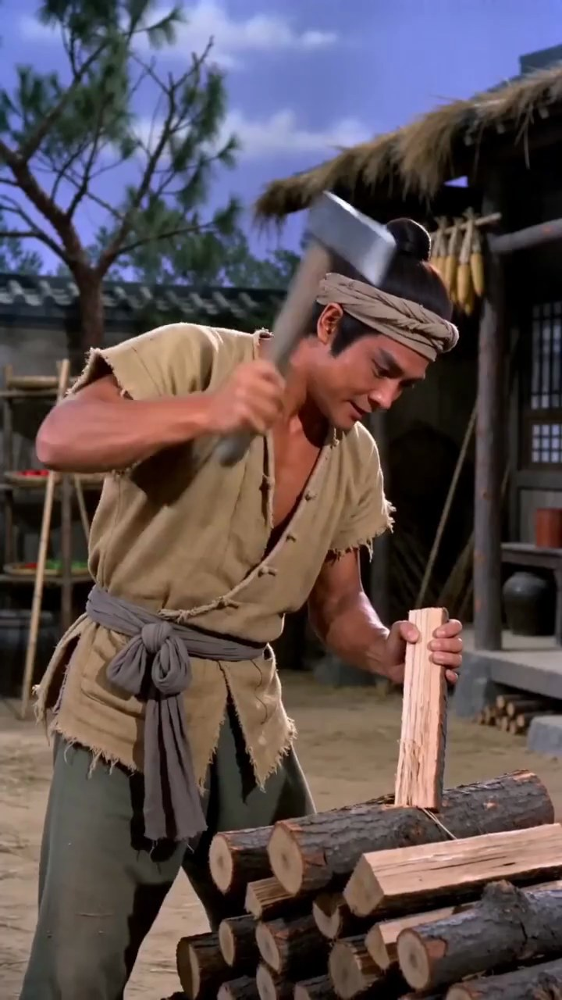
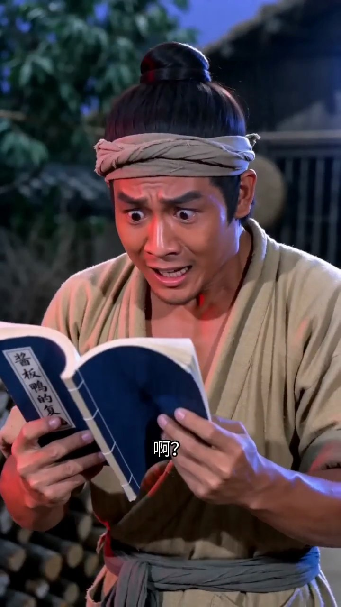

# Agent Loop 示例：小红书｜酱板鸭反转短剧

[返回项目主页](../../../README.md) · [完整模型报告](report.md)

这份结果来自 2026-10-12 对原始链接的一次**全新下载和完整分析**。报告由模型辅助生成，时间戳、证据 ID 和截图供人工核对。原视频不在仓库中。

- 原始页面：https://www.xiaohongshu.com/explore/69e09cb0000000001f0035b3
- 时长：39.40 秒；下载方式：`yt-dlp`。
- 镜头 22 个；候选帧 54 张；OCR 采样帧 79 张。
- ASR 15 条；画面文字 24 条；图片观察 23 条；时间轴证据 67 条。
- 本地最终结果有 24 张关键帧；本页只公开 3 张。

## Agent 实际做了什么

`qwen3.8-flash` 每轮依据检查点中的阶段状态选择一个受控动作；本次路径为：

`resolve_source → download → probe → transcribe → sample_frames → read_screen_text → describe_visuals → fuse_evidence → write_analysis → inspect_evidence → write_report → finish`

| 环节 | 本次作用 |
| --- | --- |
| 获取视频 | `yt-dlp` 下载，`ffprobe` 确认音视频和时长。 |
| 声音 | FFmpeg 制作音频块；百炼 `qwen-audio-3.0-asr-flash` 返回带时间戳的转写。 |
| 画面 | PySceneDetect/OpenCV 切镜头和抽帧；PaddleOCR 在本地读取文字。 |
| 视觉 | 百炼 `qwen3.8-flash` 描述镜头代表帧和最多三段无声短片。 |
| 结论 | 合并来源证据后，用 LangChain/Pydantic 调 `qwen3.8-flash` 生成结构、摘要和不确定项。 |
| 交付 | LangGraph 检查报告和证据引用；公开报告保留时间戳，截图只取三张。 |

**本次质量复核**：首次摘要和多个分段不完整；摘要曾由 repair_summary 修复。分段定向修复的模型调用返回空内容，Agent 改用强制重新分析，生成完整分段；导入路径问题修复后完成最终交付。复核路径：`repair_summary → repair_structure（失败） → write_analysis(force=true) → write_report → finish`。下面展示的是最终版本。

## 这条视频讲了什么

视频以古装男子劈柴开场，白衣女子以经典'雪山救狐报恩'台词登场，营造温情预期。狸花猫随即揭穿'她不是狐狸'，男子看到《酱板鸭的复仇》一书后闪回雪夜赠鸭场景，惊呼对方竟是那只酱板鸭。女子承认身份并高喊'此仇不报，誓不为鸭'，猫持左轮枪将其击倒。一只真鸭现身求饶，承诺'关注、点赞、转发、收藏、评论'换取性命，猫说'成交'。结尾切至卡通头像画面，字幕'记得点赞关注哦'完成对短视频互动文化的戏仿收束。全片通过三次身份反转（狐狸→猫揭穿→酱板鸭）和一次元叙事打破，将'动物报恩'套路解构为荒诞喜剧。

## 分段与证据

| 原视频时间 | 情节或观点 | 证据 ID |
| --- | --- | --- |
| 00:00–00:03 | 古装男子在茅草屋前劈柴，白衣女子推门而入，以'你是否在雪山上救过一只狐狸'发问，建立'报恩'叙事预期。 | visual_scene_000_0, visual_scene_001_0, visual_scene_002_2, asr_000_0000, ocr_0000 |
| 00:03–00:07 | 男子惊喜确认'你是那只狐狸'，女子温柔回应'我是来报恩的'，两人握手相视，营造温情氛围。 | asr_000_0001, asr_000_0002, clip_4000_8500, visual_scene_005_0, ocr_0002 |
| 00:07–00:12 | 穿白斗篷的狸花猫出现在屋顶，宣布'你被骗了，她不是狐狸'；男子随后看到一本名为'酱板鸭的复仇'的蓝色线装书，表情震惊。 | visual_scene_006_0, visual_scene_007_1, asr_000_0003, ocr_0003, visual_scene_008_0, visual_scene_009_0, ocr_0005 |
| 00:12–00:17 | 闪回雪夜：男子将酱板鸭放在受伤白狐身旁说'希望你能熬过这个冬天'。回到现实，男子指着画外惊呼'你是那只酱板鸭'。 | clip_12633_17700, visual_scene_010_1, asr_000_0004, asr_000_0006, ocr_0006, ocr_0007, ocr_0010 |
| 00:17–00:24 | 白衣女子转身叉腰，承认自己就是'一年前你送给狐狸的那只酱板鸭'，宣告'此仇不报，誓不为鸭'，将食物拟人化为复仇者。 | visual_scene_011_1, asr_000_0007, ocr_0011, ocr_0013, ocr_0014, ocr_0015 |
| 00:24–00:30 | 狸花猫举左轮手枪射击白衣女子，女子倒地；猫说'反派最忌话多，看我再给你补一枪'，画面充满白色烟雾特效。 | visual_scene_012_0, visual_scene_013_1, visual_scene_014_1, visual_scene_015_1, visual_scene_016_1, asr_000_0008, asr_000_0009, ocr_0016, ocr_0017 |
| 00:30–00:37 | 一只真实的烤鸭张嘴说'大侠饶命，给我一个改正的机会'，猫问'怎么改'，鸭答'我会关注你、点赞、转发、收藏，还会评论你的每一条视频'，猫回应'成交'。 | clip_30000_34500, visual_scene_017_1, visual_scene_018_0, visual_scene_019_0, asr_000_0010, asr_000_0011, asr_000_0012, asr_000_0013, ocr_0018, ocr_0019, ocr_0020, ocr_0021, ocr_0022 |
| 00:37–00:39 | 画面切至黑色背景上的卡通蓝色鹿头像与红色对勾图标，配字幕'记得点赞关注哦'，打破第四面墙直接向观众发出互动号召。 | visual_scene_021_2, asr_000_0014, ocr_0023 |

## 选出的三张截图

**00:00**

**00:16**

**00:38**

## 不确定与人工复核

- 发布标签含'邵氏电影'，但画面风格为写实古装而非邵氏片场布景，无法确认是否有意致敬邵氏美学或仅为话题引流。
- 猫在叙事中的身份不明：它是被救的狐狸化身、独立角色还是男子一方盟友，画面与语音均未交代。
- 白衣女子与酱板鸭之间的视觉关联（女子穿白衣、鸭为酱色）未通过特效或服装变化呈现，'女子即鸭'的设定仅靠台词建立。
- 闪回中白狐眼部带血，但全片未解释其受伤原因及与后续剧情的因果。
- 结尾卡通蓝鹿头像与正片古装场景无视觉连续性，无法确认是否为同一创作者的固定片尾模板。
- 视频未出现任何拍摄设备、地点或制作团队信息，无法判断实际拍摄场地。

[查看完整模型报告，包括视觉描述、语音和画面文字](report.md)。证据 ID 可定位模型所用记录，但不能独立证明其解释必然正确。
