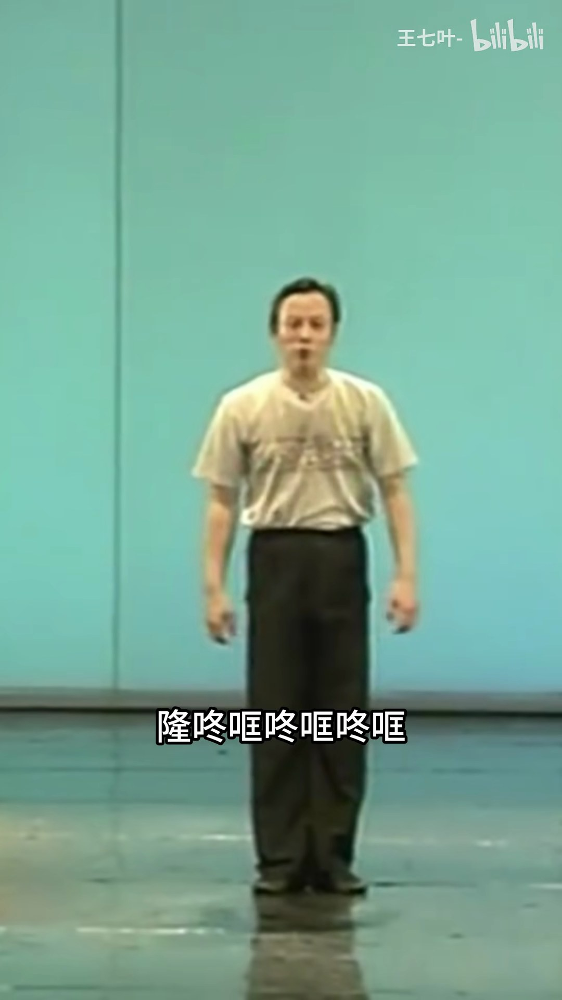
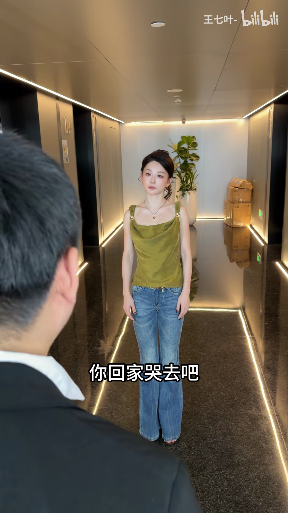

# B站示例：学以乱用

[← 返回项目主页](../../README.md)

> 本报告根据一次真实运行的最终产物整理。剧情、视觉风格和动作描述由模型辅助生成；证据 ID、时间戳与图片供人工核对。原视频没有上传到本仓库。

## 视频与本次结果

- 原始页面：[打开B站原始页面](https://www.bilibili.com/video/BV1yJaH6DEV1/)
- 页面标题：学 以 乱 用
- 时长：01:18.623；分辨率：1080 × 1920；视频编码：av1；音轨：有。
- 本次下载路径：`yt-dlp`。原始 MP4 仅留在本地 `runs/`，未进入 GitHub。

## 视频是怎样处理的

1. **识别并下载**：输入为 B站 BV 号页面。链接规范化后由 yt-dlp 的 BiliBili 提取器直接下载；本次没有用到浏览器回退。下载文件留在本地运行目录，GitHub 只展示本报告及 4 张画面。
2. **检查与切镜头**：ffprobe 验证音视频流；PySceneDetect 找到 **21** 个镜头，OpenCV 保存 **70** 张镜头候选图。分析图片宽度最多缩至 1080 像素，原始下载视频不缩放。
3. **声音与画面文字**：FFmpeg 提取音轨供 ASR，得到 **13** 条转写片段；从 **158** 张约每 500 毫秒采样的图片中，PaddleOCR 合并出 **165** 条画面文字。
4. **视觉与动作**：图片模型留下 **21** 条视觉观察；另选 **3** 个无声短片理解动作顺序。视频切换办公室、走廊与纯色背景表演场景。镜头代表帧说明人物和场景，三个短片片段补充步法动作的先后顺序；ASR 和 OCR 共同辨认台词与字幕，尤其用于纠正近音词。
5. **汇合与总结**：ASR、OCR、视觉、短片和发布信息合为 **204** 条带来源与毫秒时间的证据；本地结果选出 **24** 张关键帧，本公开报告只展示其中 **4** 张。

## 内容分析

**主题**：搞笑职场短剧：员工被开除后用各种夸张'步法'荒诞演绎离职过程

**故事或观点**：视频以'学以致用'的谐音梗'学以乱用'为主题，讲述一名员工（绿吊带女子）被'领导'（光头男子）逐步开除的故事。每次领导说出一个传统武术/戏曲步法名称（闪身步、隆咚哐、风摆柳碎步、栽楔子招手式），女子便将本应悲惨的离职经历用这些夸张步法'学以致用'地表演出来，形成强烈的荒诞喜剧反差。最终她'开心下班'，暗示她根本不在乎这份工作。

**摘要**：这是一条约79秒的B站搞笑短视频（UP主'王七叶-'），标题'学以乱用'谐音'学以致用'。视频讲述一名女员工被光头'领导'逐步开除的过程：从被批评工作不认真，到被要求收拾东西滚蛋，再到被要求签赔偿协议。核心笑点在于——每次领导说出一个传统步法/武术名称（闪身步、隆咚哐、风摆柳碎步、栽楔子招手式），女子便在被开除的悲惨场景中夸张地'学以致用'地表演这些步法，将离职变成荒诞的舞蹈秀。最终她'开心下班'，暗示对这份工作的毫不在意。视频在办公室、走廊、纯色背景棚拍之间快速切换，节奏明快，以反差制造喜剧效果。

## 按时间展开

| 原视频时间 | 片段作用 | 观察与推断 | 主要证据 ID |
| --- | --- | --- | --- |
| 00:00.000–00:05.205 | 引入 | 光头男子在蓝色纯色背景前宣布'闪身步'，切至办公室中的女子，建立'步法名称'的概念框架。 | visual_scene_000_0, visual_scene_001_2, visual_scene_002_2, visual_scene_003_0, asr_000_0000 |
| 00:05.205–00:13.981 | 冲突铺垫 | 办公室/走廊场景中，领导说'这活给你的，不用了，别干'，女子回应'没工作的话，我得……'，暗示她即将失业。 | visual_scene_004_1, asr_000_0001, ocr_0010, ocr_0016, visual_scene_005_1 |
| 00:13.981–00:27.194 | 批评升级 | 光头男子在蓝色背景前说'猴子绕花线'，切至'女士卫生间'门前场景，领导批评'天天活活不知道干，脑子里也不知道在想'，并出现'得多拿点儿'的暗示。 | visual_scene_006_0, visual_scene_007_2, visual_scene_008_1, asr_000_0003, ocr_0025 |
| 00:27.194–00:29.763 | 开除 | 女子抱着顺丰(SF)纸箱站在办公室，字幕'收拾东西滚蛋'，领导说'说那么多，滚蛋！'，正式被炒鱿鱼。 | visual_scene_009_0, asr_000_0004, ocr_0067, ocr_0068, ocr_0069 |
| 00:29.763–00:41.041 | 第一组步法演绎：隆咚哐 | 光头男子在绿色背景前表演'摇头晃脑'及'隆咚哐'节奏武术动作；切至女子在办公室抱纸箱配合'隆咚哐'做夸张舞蹈，将离职包装成节奏表演。 | visual_scene_010_0, clip_30864_35769, asr_000_0005, ocr_0078, ocr_0079 |
| 00:41.041–00:57.591 | 第二组步法演绎：风摆柳碎步 | 领导递上'赔偿协议'，说'拿公司这么多东西''没让你赔钱就不错了'，引入'风摆柳碎步'；女子在'蜂群'前台踩着协议纸跳碎步舞，男子在旁面无表情观看。 | visual_scene_013_2, asr_000_0007, ocr_0118, ocr_0121, ocr_0123 |
| 00:57.591–01:09.460 | 第三组步法演绎：栽楔子招手式 | 女子在走廊行走，领导说'以后都不用再来了'；光头男子表演'栽楔子招手式'（右手高举左手叉腰），切回女子在走廊面对男子后脑勺。 | visual_scene_017_1, asr_000_0009, ocr_0149, ocr_0150, asr_000_0010 |
| 01:09.460–01:18.612 | 收尾 | 女子在走廊，字幕'你回家哭去吧'，再次出现'栽楔子招手式'，最终画面出现'开心下班'字样，以反讽收束全片。 | asr_000_0012, visual_scene_020_0, ocr_0159, ocr_0160, ocr_0161 |

## 关键结论如何得到

| 证据 ID | 来源与时间 | 原始记录摘录 | 对结论的作用 |
| --- | --- | --- | --- |
| `ocr_0068` | paddleocr；00:27.500–00:28.500 | 收拾东西滚蛋 | 字幕写出“收拾东西滚蛋”，支撑开除情节。 |
| `clip_30864_35769` | video_clip；00:30.864–00:35.769 | 镜头与场景：全程为固定机位的中景/全景竖屏镜头，无推拉、摇移或剪辑切换。背景是一面浅青绿色的墙板，带有一条竖直接缝，地面为反光的舞台地板；画面右上角有"王七叶-bilibili"水印，下方字幕随时间依次显示"隆… | 连续片段而非单张图片展示“隆咚哐”动作。 |
| `visual_scene_013_2` | visual；00:41.041–00:44.845 | 一名女子身穿绿色吊带上衣，佩戴项链，正面站立，眼神向左侧斜视，表情严肃。画面左侧有一只穿着黑色西装袖子的手递过来一张白纸，纸上印有红色竖排文字“赔偿协议”。背景为灰白色砖纹墙面。 | 画面能看到被递出的“赔偿协议”。 |
| `ocr_0162` | paddleocr；01:15.500–01:19.000 | 开心下班 | 结尾屏幕文字“开心下班”形成反讽收束。 |

## 公开的精选关键帧

下列图片直接来自本次下载视频的抽帧。时间指原视频位置；其余候选帧和原视频不放进仓库。

| 原视频时间与说明 | 画面 |
| --- | --- |
| 00:00.150 · 纯色背景的步法引入 |  |
| 00:27.836 · 办公室中的离职冲突 |  |
| 00:33.316 · 舞台式步法表演 |  |
| 01:09.151 · 收尾段落 |  |

## 不确定性与复核

- ASR 将“隆咚哐”等词识别为近音词；报告优先呈现同步 OCR 字幕，并保留两种来源。
- 视频没有说明这些步法名称的真实来源，不能仅凭表演判断是传统武术、戏曲动作还是创作者自拟。

如需重新处理这条视频，按[项目主页](../../README.md)配置本地依赖与凭证，再把上面的原始页面链接或新的完整分享文字传给 `video-review --input`。站点可能要求新的 Cookie 或临时访问参数；本仓库不提供原视频文件。
