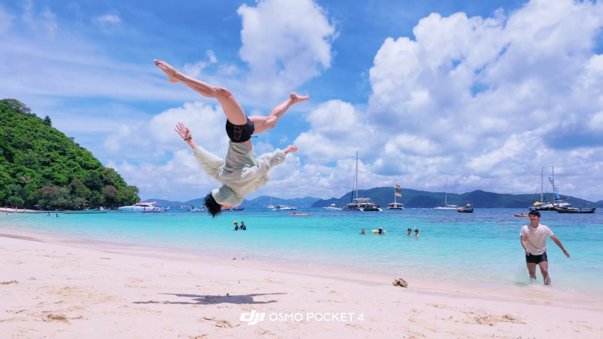
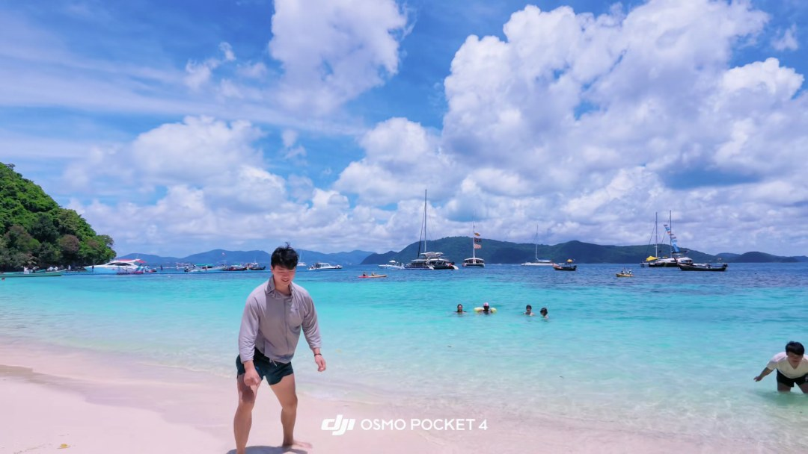
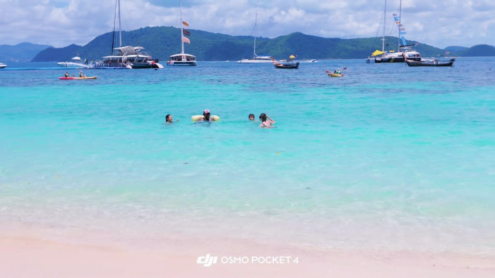

# 抖音示例：中国人会飞

[← 返回项目主页](../../README.md)

## 本次实际调用的百炼模型

这条视频已完整运行模型分析。下表中的数量是保存在最终产物中的片段或观察条数，不等于计费请求数；模型重试、拆批或复核可能增加请求。

| 节点 | 百炼模型与调用路径 | 本次输入和结果 |
| --- | --- | --- |
| `audio` | `qwen-audio-3.0-asr-flash`；`httpx` 调原生语音接口 | 1 个 FFmpeg 音频块 → 2 条带时间戳的 ASR。 |
| `vision` 图片 | `qwen3.8-flash`；OpenAI 兼容接口 | 抽取的镜头/开场图片 → 1 条画面观察。 |
| `vision` 短片 | `qwen3.8-flash`；OpenAI 兼容接口的视频输入 | 3 个去掉原音频的动作片段 → 3 条动作描述。 |
| `understand` | `qwen3.8-flash`；LangChain `ChatOpenAI` + Pydantic | 汇合 ASR、OCR 和视觉证据，生成主题、时间轴、摘要及不确定点。 |
| 条件审校/修复 | 冲突时 `qwen3.8-max`；概述残缺时 `qwen3.8-flash` | 未触发 `qwen3.8-max`；`qwen3.8-flash` 概述修复已接受。 |

下载、ffprobe、切镜头、PaddleOCR 和证据汇合由本地工具完成，不调用百炼模型。

> 本报告根据一次真实运行的最终产物整理。剧情、视觉风格和动作描述由模型辅助生成；证据 ID、时间戳与图片供人工核对。原视频没有上传到本仓库。

## 视频与本次结果

- 原始页面：[打开抖音原始页面](https://www.douyin.com/video/7684591599804937466)
- 页面标题：中国人会飞哈哈哈哈哈 外国小姐姐在给我们鼓掌👏 你看到了👉🌊🌊 #翻身极限特技 #深圳空翻#中国人会飞 #海边飞起来 #深圳毯功技巧
- 时长：00:16.850；分辨率：3840 × 2160；视频编码：hevc；音轨：有。
- 本次下载路径：`chrome-media-url+yt-dlp`。原始 MP4 仅留在本地 `runs/`，未进入 GitHub。

## 视频是怎样处理的

1. **识别并下载**：输入原本是带 modal_id 的精选搜索页。resolve_source 将该参数规范化为单条视频 URL；yt-dlp 直连未取到视频后，无头 Chrome 读取当前播放器媒体地址，再立即由 yt-dlp 下载。没有操作用户前台浏览器。
2. **检查与切镜头**：ffprobe 验证音视频流；PySceneDetect 找到 **1** 个镜头，OpenCV 保存 **12** 张镜头候选图。分析图片宽度最多缩至 1080 像素，原始下载视频不缩放。
3. **声音与画面文字**：FFmpeg 提取音轨后调用 `qwen-audio-3.0-asr-flash`，得到 **2** 条转写片段；从 **34** 张约每 500 毫秒采样的图片中，PaddleOCR 合并出 **26** 条画面文字。
4. **视觉与动作**：`qwen3.8-flash` 图片输入留下 **1** 条视觉观察；另选 **3** 个无声短片交给同一模型理解动作顺序。整条视频约 17 秒却只有一个镜头边界。若只给视觉模型一张代表帧，会漏掉翻转动作；工作流改为依据帧间变化选取三个约 4.5 秒的无声片段，才得到动作顺序。ASR 单独提取反复出现的“中国人能飞”。
5. **汇合与总结**：ASR、OCR、视觉、短片和发布信息合为 **34** 条带来源与毫秒时间的证据；LangChain 再调用 `qwen3.8-flash` 生成结构化结论。本地结果选出 **12** 张关键帧，本公开报告只展示其中 **4** 张。

## 内容分析

**主题**：两名年轻男子在热带海滩上连续表演侧手翻，全程有人反复高喊“中国人能飞”

**故事或观点**：视频记录了两名年轻男子在阳光下的热带海滩上表演侧手翻/侧空翻的过程。一名男子连续完成多个翻腾动作，另一名男子在旁观看，随后两人一同走向海边。整个过程中，画外有人反复高喊“中国人能飞”。

**摘要**：视频时长约17秒，画面记录了两名年轻男子在热带海滩上连续表演侧手翻的过程。开场时两人站在白色沙滩上，背景为绿树、山丘和蓝绿色海水。随后一名男子先后完成至少三次侧手翻/侧空翻动作，另一名男子在旁观看。视频后半段两人走向海边，画面过渡为开阔海景。全程画外有人反复高喊“中国人能飞”。

## 按时间展开

| 原视频时间 | 片段作用 | 观察与推断 | 主要证据 ID |
| --- | --- | --- | --- |
| 00:00.000–00:01.731 | 开场 | 画面为白天热带海滩，两名年轻男子赤脚站在白色沙滩上，左侧穿浅绿色上衣、右侧穿浅灰色衬衫，背景为绿树、山丘和蓝绿色海水。画面底部有DJI OSMO POCKET 4水印。 | visual_scene_000_3, ocr_0000 |
| 00:01.731–00:06.231 | 第一次与第二次翻腾 | 一名穿白色T恤的男子在沙滩中央完成侧手翻，身体横在空中后落地站稳。随后镜头转向侧面，同一名男子在另一名男子注视下再次完成侧手翻，身体腾空呈水平姿态。 | clip_1731_6231, asr_000_0000 |
| 00:07.750–00:12.250 | 第三次翻腾 | 穿灰色长袖上衣的男子张臂做起势动作，双手撑地完成侧手翻，身体在空中倒置、双腿越过头顶，随后落地站稳面向镜头，再次俯身准备下一个动作。镜头为低机位跟拍。 | clip_7750_12250, asr_000_0000 |
| 00:12.350–00:16.850 | 收尾与过渡 | 灰衣男子微笑向镜头走近并出画，白衣男子朝海水方向走去。画面过渡为开阔海景，可见多名游客在海中游泳，远处停泊着帆船和快艇。 | clip_12350_16850, asr_000_0001 |

## 关键结论如何得到

| 证据 ID | 来源与时间 | 原始记录摘录 | 对结论的作用 |
| --- | --- | --- | --- |
| `asr_000_0000` | asr；00:01.160–00:09.200 | 中国人能飞，中国人能飞，中国人能飞，中国人能 | 语音识别记录重复口号；下一段 ASR 与它按顺序拼接，避免把技术分块误写为两句话。 |
| `clip_1731_6231` | video_clip；00:01.731–00:06.231 | 场景：热带海滩，白色沙滩、碧蓝海水、远处停泊的帆船和绿色山丘，天空有大片白云。画面底部中央有“DJI OSMO POCKET 4”字样水印。海中另有数名游泳者。 动作与事件顺序： - 0–1秒：一名穿白色T恤、… | 动作片段显示前半段的侧手翻。 |
| `clip_7750_12250` | video_clip；00:07.750–00:12.250 | 动作描述： - 视频开始时，一名身穿灰色长袖上衣、深色短裤的男子站在白色沙滩上，双臂向两侧张开、身体前倾，正在做起势动作。 - 随后他双手撑地，完成一个侧手翻/侧空翻动作，身体在空中倒置，双腿张开越过头顶。 -… | 中段片段显示起势、腾空与落地。 |
| `clip_12350_16850` | video_clip；00:12.350–00:16.850 | 整体画面：晴天海滩，白色沙滩、碧蓝海水，远处停泊着帆船和快艇，背景是绿色岛屿与蓝天白云，画面下方有“DJI OSMO POCKET 4”水印。 动作与事件顺序： - 0–1秒：中景镜头对准一名穿浅灰色长袖衬衫、… | 末段片段说明人物离开画面、海景收尾。 |

## 公开的精选关键帧

下列图片直接来自本次下载视频的抽帧。时间指原视频位置；其余候选帧和原视频不放进仓库。

| 原视频时间与说明 | 画面 |
| --- | --- |
| 00:00.150 · 海滩与两名人物 |  |
| 00:06.250 · 空中翻转瞬间 |  |
| 00:11.250 · 后半段翻转 |  |
| 00:16.250 · 海景收束 |  |

## 不确定性与复核

- 发布标题提到其他观众鼓掌，但已选画面与动作片段不能据此确认画面外人物或动作。
- 画面底部出现设备型号字样水印；水印本身不能证明实际拍摄设备或地点。
- 本次模型曾返回不完整的不确定项，交付前剔除了残缺片段并保留复核标记。

如需重新处理这条视频，按[项目主页](../../README.md)配置本地依赖与凭证，再把上面的原始页面链接或新的完整分享文字传给 `video-review --input`。站点可能要求新的 Cookie 或临时访问参数；本仓库不提供原视频文件。
