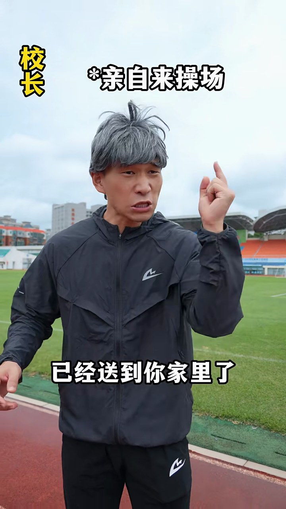
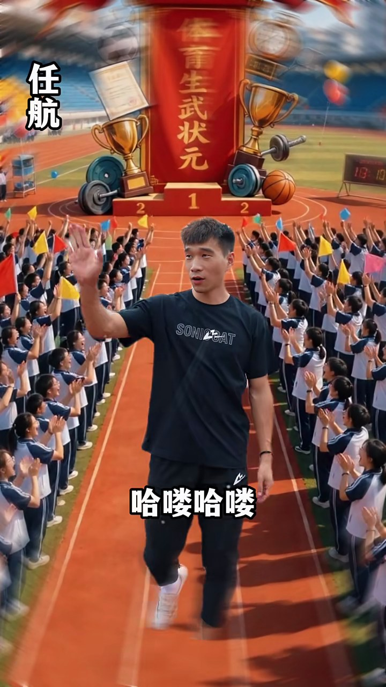
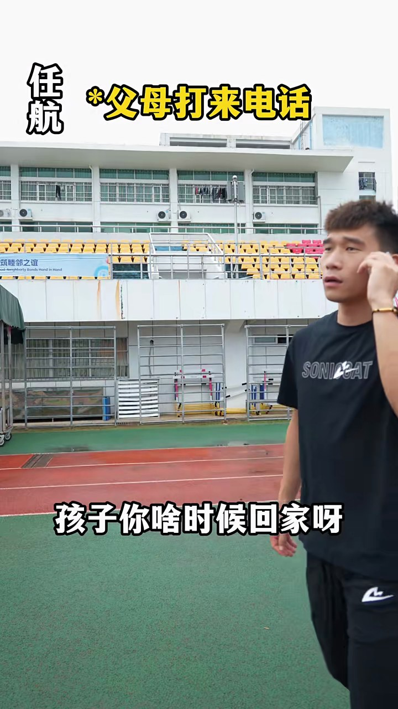

# 快手示例：哪个状元更有含金量

[← 返回项目主页](../../README.md)

## 本次实际调用的百炼模型

这条视频已完整运行模型分析。下表中的数量是保存在最终产物中的片段或观察条数，不等于计费请求数；模型重试、拆批或复核可能增加请求。

| 节点 | 百炼模型与调用路径 | 本次输入和结果 |
| --- | --- | --- |
| `audio` | `qwen-audio-3.0-asr-flash`；`httpx` 调原生语音接口 | 1 个 FFmpeg 音频块 → 23 条带时间戳的 ASR。 |
| `vision` 图片 | `qwen3.8-flash`；OpenAI 兼容接口 | 抽取的镜头/开场图片 → 20 条画面观察。 |
| `vision` 短片 | `qwen3.8-flash`；OpenAI 兼容接口的视频输入 | 3 个去掉原音频的动作片段 → 3 条动作描述。 |
| `understand` | `qwen3.8-flash`；LangChain `ChatOpenAI` + Pydantic | 汇合 ASR、OCR 和视觉证据，生成主题、时间轴、摘要及不确定点。 |
| 条件审校/修复 | 冲突时 `qwen3.8-max`；概述残缺时 `qwen3.8-flash` | 未触发 `qwen3.8-max` 审校，也无需追加概述修复。 |

下载、ffprobe、切镜头、PaddleOCR 和证据汇合由本地工具完成，不调用百炼模型。

> 本报告根据一次真实运行的最终产物整理。剧情、视觉风格和动作描述由模型辅助生成；证据 ID、时间戳与图片供人工核对。原视频没有上传到本仓库。

## 视频与本次结果

- 原始页面：[打开快手原始页面](https://www.kuaishou.com/short-video/3x56qx9f9beqtmm)
- 页面标题：大家认为哪个状元更有含金量 #北体航航 #体育生 #田径-快手
- 时长：00:57.667；分辨率：720 × 1280；视频编码：hevc；音轨：有。
- 本次下载路径：`chrome-media-url+yt-dlp`。原始 MP4 仅留在本地 `runs/`，未进入 GitHub。

## 视频是怎样处理的

1. **识别并下载**：当前 yt-dlp 未直接支持这条快手 short-video 页面。程序改用后台无头 Chrome 读取播放器的媒体 URL，必要时重试，再由 yt-dlp 保存 MP4。报告中只使用不含追踪参数的公开页面地址。
2. **检查与切镜头**：ffprobe 验证音视频流；PySceneDetect 找到 **19** 个镜头，OpenCV 保存 **57** 张镜头候选图。分析图片宽度最多缩至 1080 像素，原始下载视频不缩放。
3. **声音与画面文字**：FFmpeg 提取音轨后调用 `qwen-audio-3.0-asr-flash`，得到 **23** 条转写片段；从 **116** 张约每 500 毫秒采样的图片中，PaddleOCR 合并出 **129** 条画面文字。
4. **视觉与动作**：`qwen3.8-flash` 图片输入留下 **20** 条视觉观察；另选 **3** 个无声短片交给同一模型理解动作顺序。最关键的开场信息在第一秒：上方题目、左侧“体考状元”、右侧“高考749分”。仅选同镜头的最高质量后续帧会漏掉并列布局，模型曾错误地把两个标签合成一人的属性。工作流现额外分析开场帧，并保留每段动作模型结果的缓存。
5. **汇合与总结**：ASR、OCR、视觉、短片和发布信息合为 **177** 条带来源与毫秒时间的证据；LangChain 再调用 `qwen3.8-flash` 生成结构化结论。本地结果选出 **24** 张关键帧，本公开报告只展示其中 **4** 张。

## 内容分析

**主题**：以娱乐短剧形式对比'体考状元'与'高考749分'的含金量，通过夸张情节展现体育生武状元被各方追捧的场景。

**故事或观点**：视频为虚构情景短剧。开头以'体考状元'与'高考749分'两个并列标签设置对比悬念，随后围绕体考状元任航展开：校长送10万元奖金并劝报清北、学弟求签名、体育大学致电承诺学费全免保研、品牌方包揽全部训练装备、父母来电称县长要把女儿介绍给他。全片以'武状元你终于来了'反复出现为线索，用喜剧夸张手法塑造体育生状元'香饽饽'形象，与高考状元形成对照，引发观众对两种状元含金量的讨论。

**摘要**：本视频为快手平台上的娱乐短剧，时长约57.7秒。开头以'体考状元'与'高考749分'两个并列标签设置对比悬念，标题提问'哪个状元更有含金量'。随后剧情围绕体考状元'任航'展开：校长亲自到操场送10万元奖金并劝报清北；学弟求签名合影；体育大学致电承诺学费全免保研；品牌方递红包并包揽全部训练装备；父母来电称县长要把女儿介绍给他。全片以夸张喜剧手法塑造体育生状元被各方争抢的形象，与高考状元形成对照，引发观众讨论。视频为虚构情景剧，非真实事件记录。

## 按时间展开

| 原视频时间 | 片段作用 | 观察与推断 | 主要证据 ID |
| --- | --- | --- | --- |
| 00:00.000–00:05.200 | 开头对比设置 | 画面展示一名年轻男子站在红色跑道上，顶部横幅写'哪个状元更有含金量'，左右分别标注'体考状元'和'高考749分'。两个标签并列出现，代表不同状元之间的比较，不能合并为同一人物属性。 | visual_scene_000_0, ocr_0000, ocr_0004, ocr_0006, asr_000_0000 |
| 00:05.200–00:22.233 | 校长送奖金与劝报清北 | 教练告知武状元任航校长找他。校长（戴灰色假发）亲自到操场，宣布学校批的10万元奖金已送到家中，并建议他填清北，称'咱们学校还没出过清北呢'。任航回应'我考虑一下吧'。 | visual_scene_001_0, visual_scene_002_0, visual_scene_003_2, visual_scene_005_1, visual_scene_007_0 |
| 00:22.233–00:31.366 | 同学追捧与学弟求签名 | 任航沿跑道走来，字幕显示同学讨论'这就是单招状元吗''这可是全国第一呀'。学弟刘梦手持手机请求签名合影，任航答应'可以啊学弟，我给你照相，来吧'。 | clip_22233_26867, visual_scene_010_1, visual_scene_011_1, visual_scene_012_1, asr_000_0009 |
| 00:31.366–00:42.360 | 体育大学致电抢人 | 任航接电话，字幕提示'体育大学致电'，对方称让他报该校、学费全免还保研。任航再次回答'我考虑一下吧'。 | visual_scene_013_2, visual_scene_014_1, visual_scene_015_0, asr_000_0014, asr_000_0015 |
| 00:42.560–00:51.160 | 品牌方送装备与红包 | 体育品牌代表（穿浅蓝色T恤）递上红色信封，承诺包揽所有训练装备、鞋、衣服、背包、袜子。任航感叹'这也太爽了吧'。 | clip_40933_50200, visual_scene_016_0, asr_000_0016, asr_000_0017, asr_000_0018 |
| 00:52.600–00:57.520 | 父母来电与县长介绍女儿 | 任航接父母电话，被告知'县长也来了，说要把他女儿介绍给你'。任航惊讶回应'啊？我马上到'，随即转身离开。 | clip_51333_57300, visual_scene_017_0, asr_000_0019, asr_000_0020, asr_000_0021 |

## 关键结论如何得到

| 证据 ID | 来源与时间 | 原始记录摘录 | 对结论的作用 |
| --- | --- | --- | --- |
| `visual_scene_000_0` | visual；00:00.000–00:05.200 | 一名留着黑色短发的年轻男子站在红色塑胶跑道上，背景是城市的高层住宅楼。他身穿黑色短袖T恤和黑色运动长裤，左手腕戴着手链。他正看向画面左侧，左臂抬起，食指指向画面右侧，右手横在胸前托住左臂。画面顶部有一个黄色的圆… | 开场帧描述明确记录两组文字分居左右，支持“对照标签”而非人物双重身份。 |
| `ocr_0004` | paddleocr；00:00.500–00:01.500 | 体考状元 | 左侧画面文字为“体考状元”。 |
| `ocr_0006` | paddleocr；00:01.000–00:01.500 | 高考749分 | 右侧画面文字为“高考749分”。 |
| `asr_000_0003` | asr；00:09.640–00:13.360 | 武状元你终于来了，学校给你批的 10 万元奖金已经送到你家里了。 | 校长送出十万元奖金的台词来自音频识别。 |
| `ocr_0116` | paddleocr；00:54.000–00:55.000 | 县长也来了 | 末尾字幕为“县长也来了”；对应 ASR 误听成“店长”，两种来源均保留。 |

## 公开的精选关键帧

下列图片直接来自本次下载视频的抽帧。时间指原视频位置；其余候选帧和原视频不放进仓库。

| 原视频时间与说明 | 画面 |
| --- | --- |
| 00:00.150 · 左右并列的对照标签 |  |
| 00:12.483 · 校长奖励桥段 |  |
| 00:33.966 · 大学来电桥段 |  |
| 00:52.825 · 父母来电收尾 |  |

## 不确定性与复核

- “高考749分”是开头并列标签，视频没有说明其对应的具体人物，也没有展开另一个状元的独立故事线。
- 奖金、免学费保研、介绍女儿等属于短剧情节，不能当作真实事件认证。
- ASR 的“店长”与 OCR 的“县长”冲突，报告呈现冲突，不自动宣称语音一定是哪一个词。

如需重新处理这条视频，按[项目主页](../../README.md)配置本地依赖与凭证，再把上面的原始页面链接或新的完整分享文字传给 `video-review --input`。站点可能要求新的 Cookie 或临时访问参数；本仓库不提供原视频文件。
