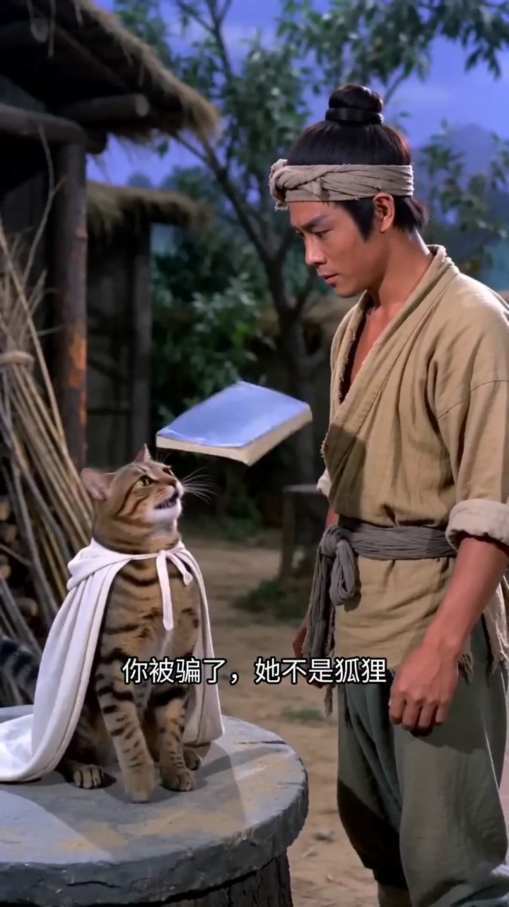
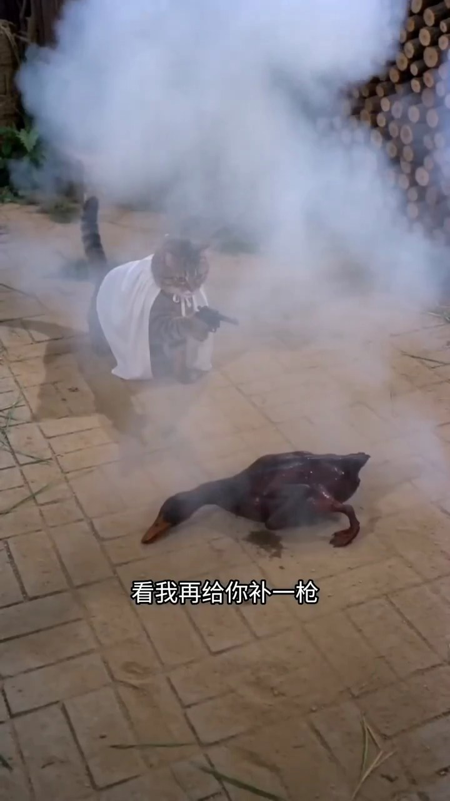

# 小红书示例：酱板鸭反转短剧

[← 返回项目主页](../../README.md)

## 本次实际调用的百炼模型

这条视频已完整运行模型分析。下表中的数量是保存在最终产物中的片段或观察条数，不等于计费请求数；模型重试、拆批或复核可能增加请求。

| 节点 | 百炼模型与调用路径 | 本次输入和结果 |
| --- | --- | --- |
| `audio` | `qwen-audio-3.0-asr-flash`；`httpx` 调原生语音接口 | 1 个 FFmpeg 音频块 → 15 条带时间戳的 ASR。 |
| `vision` 图片 | `qwen3.8-flash`；OpenAI 兼容接口 | 抽取的镜头/开场图片 → 22 条画面观察。 |
| `vision` 短片 | `qwen3.8-flash`；OpenAI 兼容接口的视频输入 | 3 个去掉原音频的动作片段 → 3 条动作描述。 |
| `understand` | `qwen3.8-flash`；LangChain `ChatOpenAI` + Pydantic | 汇合 ASR、OCR 和视觉证据，生成主题、时间轴、摘要及不确定点。 |
| 条件审校/修复 | 冲突时 `qwen3.8-max`；概述残缺时 `qwen3.8-flash` | `qwen3.8-max` 审校已接受。 |

下载、ffprobe、切镜头、PaddleOCR 和证据汇合由本地工具完成，不调用百炼模型。

> 本报告根据一次真实运行的最终产物整理。剧情、视觉风格和动作描述由模型辅助生成；证据 ID、时间戳与图片供人工核对。原视频没有上传到本仓库。

## 视频与本次结果

- 原始页面：[打开小红书原始页面](https://www.xiaohongshu.com/explore/69e09cb0000000001f0035b3)
- 页面标题：故事要从刷到那只酱板鸭开始说起
- 时长：00:39.404；分辨率：720 × 1280；视频编码：h264；音轨：有。
- 本次下载路径：`yt-dlp`。原始 MP4 仅留在本地 `runs/`，未进入 GitHub。

## 视频是怎样处理的

1. **识别并下载**：用户提供的分享链接带临时访问参数；yt-dlp 使用原始分享地址直接下载。公开报告只保留不含访问参数的 explore 页面地址；GitHub 不保存分享令牌或原视频。
2. **检查与切镜头**：ffprobe 验证音视频流；PySceneDetect 找到 **22** 个镜头，OpenCV 保存 **54** 张镜头候选图。分析图片宽度最多缩至 1080 像素，原始下载视频不缩放。
3. **声音与画面文字**：FFmpeg 提取音轨后调用 `qwen-audio-3.0-asr-flash`，得到 **15** 条转写片段；从 **79** 张约每 500 毫秒采样的图片中，PaddleOCR 合并出 **24** 条画面文字。
4. **视觉与动作**：`qwen3.8-flash` 图片输入留下 **22** 条视觉观察；另选 **3** 个无声短片交给同一模型理解动作顺序。这条短剧快速切换人物、猫和鸭子。22 个镜头的代表帧解释空间与角色，三个短视频片段补足动作和转场；ASR 与 OCR 对照台词、书名以及末尾互动提示。角色身份有叙事反转，报告保留仍不确定的归属。
5. **汇合与总结**：ASR、OCR、视觉、短片和发布信息合为 **66** 条带来源与毫秒时间的证据；LangChain 再调用 `qwen3.8-flash` 生成结构化结论。本地结果选出 **24** 张关键帧，本公开报告只展示其中 **4** 张。

## 内容分析

**主题**：抽象反转短剧：以邵氏武侠风格演绎'雪山救狐'故事的层层解构，最终落脚于引导观众互动（点赞、关注、转发、收藏、评论）。

**故事或观点**：一名樵夫一年前在雪山上救了一只狐狸并送了一只酱板鸭。一年后，一位白衣女子自称是狐狸来报恩，却被一只虎斑猫揭穿'她不是狐狸'。樵夫翻开《酱板鸭的复仇》一书，发现真正的'复仇者'竟是自己当年送给狐狸的那只酱板鸭。酱板鸭（白衣女子形态）拔剑要报仇，却被持枪的虎斑猫一枪打回原形（深棕色鸭子）。鸭子求饶，承诺'关注、点赞、转发、收藏、评论每一条视频'，猫说'成交'。全片以荒诞逻辑链（狐狸→猫→酱板鸭→鸭子）制造喜剧效果，本质是互动引导内容。

**摘要**：这是一条约39秒的抽象反转短剧，模仿邵氏武侠电影风格。故事以'雪山救狐报恩'的经典桥段开场，随后通过三次身份反转（狐狸→猫→酱板鸭→鸭子）制造荒诞喜剧效果。最终'反派'酱板鸭被持枪虎斑猫一枪打回原形，以'关注、点赞、转发、收藏、评论'作为求饶条件达成和解。全片本质是以娱乐化叙事包装的互动引导内容，标签#邵氏电影 #抽象 #反转 #萌宠准确概括了风格与目的。

## 按时间展开

| 原视频时间 | 片段作用 | 观察与推断 | 主要证据 ID |
| --- | --- | --- | --- |
| 00:00.000–00:08.000 | 铺垫 | 邵氏风格开场，樵夫劈柴→白衣女子出现问'是否在雪山上救过一只狐狸'→男子问'你是那只狐狸'→女子答'我是来报恩的'→两人握手。建立经典报恩叙事。 | visual_scene_000_1, visual_scene_001_0, asr_000_0000, ocr_0000, visual_scene_002_2 |
| 00:08.000–00:12.000 | 第一次反转 | 虎斑猫披白布出现，画外音/字幕揭示'你被骗了，她不是狐狸'。男子低头看猫，猫抬头看一本蓝色书《酱板鸭的复仇》。叙事从'狐狸报恩'转向'酱板鸭复仇'。 | visual_scene_006_0, visual_scene_007_1, asr_000_0003, ocr_0003, visual_scene_008_0 |
| 00:12.000–00:17.000 | 闪回与认知冲击 | 闪回雪夜：男子将酱板鸭放在受伤白狐身上，说'给你一只酱板鸭，希望你能熬过这个冬天'。切回现实，男子震惊翻书，喊出'你是那只酱板鸭？'。 | clip_12633_17700, visual_scene_010_1, asr_000_0004, ocr_0006, ocr_0007 |
| 00:17.000–00:25.000 | 高潮：复仇对峙 | 白衣女子（酱板鸭化身）背剑现身，宣告'我就是一年前你送给狐狸的那只酱板鸭，此仇不报誓不为鸭'。虎斑猫披斗篷持左轮手枪登场。女子拔剑喊'看剑！'。 | visual_scene_011_1, ocr_0011, asr_000_0007, ocr_0012, ocr_0013 |
| 00:25.000–00:30.000 | 反转中的反转：猫枪制敌 | 虎斑猫持枪射击，说'喵了个咪，反派最忌话多，看我再给你补一枪'。烟雾中白衣女子倒地，地上出现一只深棕色鸭子（酱板鸭被打回原形）。 | visual_scene_014_1, asr_000_0009, ocr_0016, visual_scene_015_1, ocr_0017 |
| 00:30.000–00:37.000 | 和解与互动引导 | 鸭子求饶'大侠饶命，给我一个改正的机会'。猫问'怎么改？'鸭子答'我会关注你，点赞、转发、收藏，还会评论你的每一条视频'。猫说'成交'。 | clip_30000_34500, visual_scene_017_1, ocr_0018, asr_000_0010, visual_scene_018_0 |
| 00:37.000–00:39.400 | 结尾CTA | 黑底卡通鹿图标出现，配文'记得点赞关注哦~'，语音同步'记得点赞关注哦'。 | visual_scene_021_2, ocr_0023, asr_000_0014 |

## 关键结论如何得到

| 证据 ID | 来源与时间 | 原始记录摘录 | 对结论的作用 |
| --- | --- | --- | --- |
| `asr_000_0000` | asr；00:01.160–00:03.320 | 你是否在雪山上救过一只狐狸？ | 语音提出“是否在雪山救过狐狸”，建立最初的报恩叙事。 |
| `visual_scene_008_0` | visual；00:10.900–00:11.767 | 一双手捧着一本蓝色封面的书，书名为“酱板鸭的复仇”。 | 画面中的书名《酱板鸭的复仇》提示第一次反转。 |
| `visual_scene_015_1` | visual；00:27.033–00:28.833 | 画面中，一只虎斑猫披在白色斗篷里，四肢着地蹲伏在铺有地砖的地面上，嘴里叼着那把黑色左轮手枪。猫正低头看着前方躺着的一位女子。女子身穿白色古装，平躺在地上，双臂向两侧张开，眼睛睁开，头部转向左侧。背景右侧有一堆整… | 画面出现鸭子，支持后半段身份反转。 |
| `asr_000_0012` | asr；00:33.360–00:36.840 | 我会关注你，点赞、转发、收藏，还会评论你的每一条视频。 | 鸭子的互动承诺由语音证据给出。 |
| `ocr_0023` | paddleocr；00:38.000–00:39.500 | 记得点赞关注哦~ | 片尾画面文字提示点赞关注。 |

## 公开的精选关键帧

下列图片直接来自本次下载视频的抽帧。时间指原视频位置；其余候选帧和原视频不放进仓库。

| 原视频时间与说明 | 画面 |
| --- | --- |
| 00:02.767 · 白衣女子进入故事 |  |
| 00:09.616 · 猫揭示身份疑点 |  |
| 00:16.433 · 人物翻看复仇故事 |  |
| 00:29.483 · 鸭子现身 |  |

## 不确定性与复核

- 白衣女子、虎斑猫与“酱板鸭”之间的身份关系依赖剧情表达；画面和台词仍有角色归属不明之处。
- 某些小字 OCR 结果可能是背景误识别，报告只用能与主线互相印证的文字作关键依据。

如需重新处理这条视频，按[项目主页](../../README.md)配置本地依赖与凭证，再把上面的原始页面链接或新的完整分享文字传给 `video-review --input`。站点可能要求新的 Cookie 或临时访问参数；本仓库不提供原视频文件。
