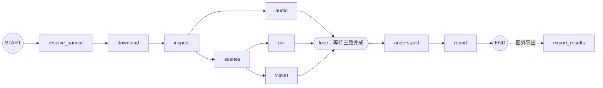
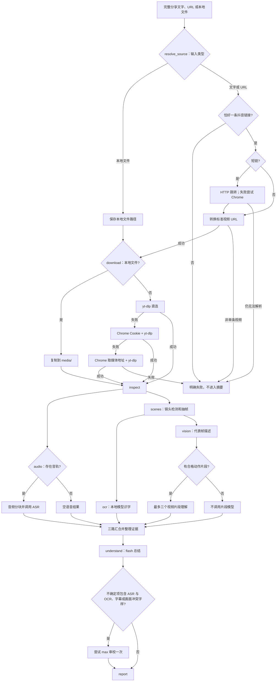

# 抖音视频解析工程：架构、路径与运行说明

> 本文记录最初的抖音实现与 2026-10-03 实测。当前入口已扩展为 B站、抖音、快手、小红书共用同一 LangGraph 分析图；四平台链接格式和运行命令以 [README.md](README.md) 为准。历史示例中将 `runs/20261003-171034/429efbe6b4eaee3b/` 标为校园视频目录，但该路径现存文件实际指向另一条视频；校园样例的内部目录是 `runs/c997bae4e82049de/`。

本文说明原始实现从一段抖音分享文字到最终报告的执行过程。工程是 **Python CLI + LangGraph `StateGraph` + LangChain 文本链 + 百炼模型适配器**。LangGraph 负责节点顺序、并行汇合、检查点和部分重试；下载、抽帧、OCR、关键帧选择等固定工作使用普通程序。流程没有自主 Agent，也不会调用当前对话的 ChatGPT 模型解析视频。

## 1. 先看一次调用会得到什么

输入可以是标准视频 URL、含 `modal_id` 的抖音精选链接，或微信等应用中复制的一整段抖音分享文字。分享文字**必须含一条抖音链接**；只有描述而没有链接时，程序不会靠搜索猜测视频。`--file` 则接收本地视频。入口是 [`douyin-review`](douyin_review/cli.py)，由 [`pyproject.toml`](pyproject.toml) 注册。

一次调用有三个不同位置：

| 位置 | 谁决定路径 | 放什么 |
| --- | --- | --- |
| `runs/<运行标识>/<输入哈希>/` | CLI 的 `--output-dir` 与输入内容 | 下载的**原视频**、各节点 JSON、临时音频和图片；供续跑与排错。 |
| `runs/<运行标识>/checkpoints.sqlite` | `--output-dir` | LangGraph 的 SQLite 检查点。 |
| `results/<运行标识>/` | CLI 的 `--result-dir` | 简洁交付：`report.md`、`analysis.json`、`keyframes/`；默认**不复制原视频**。 |
| `logs/<运行标识>.log` | 调用命令中的 `tee`，不是程序自动创建 | 终端实际输出的节点进度与错误。 |

例如用户的一次实测传入 `--output-dir "$PWD/runs/20261003-171034"` 和 `--result-dir "$PWD/results/20261003-171034"`，原视频实际在 `runs/20261003-171034/429efbe6b4eaee3b/media/source.mp4`，报告在 `results/20261003-171034/report.md`。内部的 `429efbe6b4eaee3b` 是输入哈希的前 16 位，不是视频标题或用户需要填写的名称。

## 2. 项目路径地图

以下路径相对于本项目根目录 `/path/to/video-download-analysis/`。路径中的 `*` 表示按视频或运行生成的内容。

| 路径 | 作用 |
| --- | --- |
| [`README.md`](README.md) | 快速安装、凭证和调用说明。 |
| 本文 `工程架构与运行说明.md` | 全工程路径、图、节点、模型次数、恢复操作。 |
| [`抖音视频解析实施方案.md`](抖音视频解析实施方案.md) | 方案背景与早期实测记录。 |
| `下载抖音视频的工具.md` | 用户提供的 yt-dlp 和百炼资料；历史明文凭证已移除，程序也不自动读取该文档。 |
| [`pyproject.toml`](pyproject.toml) | Python 依赖、可选 OCR/浏览器依赖、`douyin-review` 和 `douyin-review-preflight` 命令入口。 |
| [`.env.example`](.env.example) | 环境变量名称示例；程序不自动加载 `.env`。 |
| [`douyin_review/cli.py`](douyin_review/cli.py) | 解析参数、建立运行目录、创建 SQLite 检查点、启动图并打印节点进度、调用最终导出。 |
| [`douyin_review/workflow.py`](douyin_review/workflow.py) | `VideoState`、10 个 LangGraph 节点、并行边、汇合边、模型节点重试策略。 |
| [`douyin_review/media.py`](douyin_review/media.py) | 分享链接提取与短链跳转、yt-dlp/Chrome 下载回退、ffprobe/FFmpeg、镜头检测、抽帧和关键帧筛选。 |
| [`douyin_review/ocr.py`](douyin_review/ocr.py) | 本地 PaddleOCR、重复文字合并、现成 SRT 字幕解析。 |
| [`douyin_review/models.py`](douyin_review/models.py) | 百炼语音、图片、视频、文本总结和可选审校适配器；凭证从环境变量读取。 |
| [`douyin_review/storage.py`](douyin_review/storage.py) | JSON 的临时文件写入与原子替换、读取。 |
| [`douyin_review/report.py`](douyin_review/report.py) | 把结构化结果、完整转写、OCR 和关键帧渲染为 Markdown。 |
| [`douyin_review/export.py`](douyin_review/export.py) | 将内部结果整理成只含两份文件和 `keyframes/` 的可移动交付目录；拒绝覆盖非空目录。 |
| [`douyin_review/preflight.py`](douyin_review/preflight.py) | 可选的小样本百炼接口检查；**会额外调用付费模型**，不是每条视频的必经节点。 |
| [`tests/test_workflow.py`](tests/test_workflow.py) | 分享文字、视频处理、模型接口形状、图与导出等自动测试。 |
| `.venv/`、`*.egg-info/`、`__pycache__/`、`.pytest_cache/` | 安装或测试生成的本地文件；不是业务产物。 |
| `runs/`、`results/`、`logs/` | 分别为内部运行数据、简洁交付和 shell 日志。`runs/` 在 `.gitignore` 中；`results/` 与 `logs/` 需自行决定是否长期保存或提交。 |

一个运行目录的主要文件如下；某些子目录会因视频没有字幕、没有可选动作片段等而缺席：

```text
runs/<运行标识>/
├── checkpoints.sqlite             # 图检查点
└── <输入哈希>/
    ├── source.json                # 规范化后的视频 URL 和输入类型
    ├── media.json                 # 原视频路径、下载方式、页面信息
    ├── media/<实际文件名>.mp4      # 原视频；浏览器媒体地址回退时通常为 source.mp4
    ├── media/<实际文件名>.info.json # yt-dlp 元数据，若本次下载产生
    ├── probe.json                 # 时长、分辨率、音轨、字幕轨和发布信息
    ├── audio/chunk_*.mp3          # FFmpeg 切出的音频块
    ├── asr.json                   # 音频块索引、带时间戳的识别片段
    ├── scenes.json                # 镜头区间、候选图、OCR 采样图路径
    ├── candidates/*.jpg           # 镜头候选图，也是关键帧来源
    ├── ocr_samples/*.jpg          # 约每 500 ms 一张的 OCR 采样图
    ├── ocr.json                   # 合并后的画面文字及现成字幕
    ├── visual_batches/*.json      # 已完成的图片模型批次缓存
    ├── clips/*.mp4                # 可选动作分析片段，不含原音频
    ├── visual.json                # 图片描述与片段动作描述
    ├── evidence.json              # 统一时间轴证据与关键帧初选
    ├── analysis.json              # 内部结构化结论和中间文件路径
    └── report.md                  # 内部完整报告
```

交付目录的 `analysis.json` 与内部同名文件用途稍有不同：导出器把完整语音、OCR、视觉和证据装入一个 JSON，关键帧路径改为相对路径，去掉内部绝对文件引用。交付目录只有 `report.md`、`analysis.json` 和 `keyframes/*.jpg`。

## 3. LangGraph 图与条件分支

### 3.1 实际图的固定边

[`build_graph()`](douyin_review/workflow.py) 建立 `StateGraph(VideoState)`，实际边如下：



这里的边是固定的：`inspect` 完成后启动 `audio` 与 `scenes`；`scenes` 完成后启动 `ocr` 与 `vision`；`fuse` 要等 `audio`、`ocr`、`vision` 三路都完成。只有 `vision` 和 `understand` 配了 LangGraph 节点级重试。`export_results` 由 CLI 在图结束后执行，不是图节点。图使用 `stream_mode="updates"`，所以终端在节点完成时打印 `完成：节点名`。[LangGraph Graph API](https://docs.langchain.com/oss/python/langgraph/graph-api) 对状态、节点和边的定义与此一致。

### 3.2 哪些情况改变节点内部动作

下面的菱形判断是**节点函数内部的普通 Python 条件**，当前代码没有调用 `add_conditional_edges`；节点本身仍按上图运行。



下载三种办法都失败、无法识别链接、媒体无视频流或必需模型失败时，会报错停止；不会把失败当成空视频继续生成一份貌似完整的报告。视频片段模型只在满足选择条件时调用；语音识别只在有音轨时调用。

## 4. 每个节点的输入、工作与输出

| 节点 | 何时运行与主要工作 | 读入 → 写出 | 模型调用 |
| --- | --- | --- | --- |
| `resolve_source` | 图的第一个节点。筛出唯一抖音链接；标准视频地址直接规范化，`v.douyin.com` 短链先逐级检查 HTTPS 抖音域名跳转，失败再用专用 Chrome 解析。`--file` 记录本地路径。 | `raw_input`/`local_file` → `source.json`、`source_url` | 无 |
| `download` | 本地文件复制；远程地址依次试 yt-dlp 直连、专用 Chrome Cookie、Chrome 页面 `video.currentSrc`/媒体响应地址后由 yt-dlp 下载。 | `source_url` → `media/`、`media.json` | 无 |
| `inspect` | ffprobe 检查有效时长、音视频流、尺寸、字幕轨；有可用字幕则 FFmpeg 导出。浏览器回退时从页面信息补标题和描述。 | `media.json` → `probe.json`、可选字幕文件 | 无 |
| `audio` | 有音轨才提取单声道 16 kHz MP3，约 180 秒一块、相邻重叠 1 秒；识别后把块内时间换算为原视频毫秒并去除重叠文字。无音轨写空结果。 | `media.json`、`probe.json` → `audio/`、`asr.json` | `qwen-audio-3.0-asr-flash`，每音频块正常 1 次 |
| `scenes` | PySceneDetect `AdaptiveDetector` 检测边界；镜头内部抽候选，约每 500 ms 取 OCR 样本。分析图宽度最多 1080 像素；原视频保留原分辨率。 | 原视频、`probe.json` → `scenes.json`、`candidates/`、`ocr_samples/` | 无 |
| `ocr` | PaddleOCR 在本机识字，过滤低置信度结果，按文字与画面区域合并连续重复项；额外解析现成 SRT 字幕。每 10 张显示一次进度。 | `scenes.json`、字幕 → `ocr.json` | 本地 PaddleOCR 对每张样本推理；百炼 0 次 |
| `vision` | 每镜头选质量最高的代表帧，最多 24 张；按每批最多 6 张送图片模型。再用图像变化和镜头密度挑最多 3 个动作片段，FFmpeg 缩成小视频后逐段送视频模型。 | `scenes.json`、原视频 → `visual_batches/`、可选 `clips/`、`visual.json` | `qwen3.8-flash`；正常最多 4 次图片批次 + 3 次片段请求 |
| `fuse` | 把 ASR、OCR、字幕、画面描述、片段动作和发布信息排到同一毫秒时间轴，赋证据 ID。按镜头覆盖、质量、文字/语音对应关系和感知哈希选最多 24 张关键帧。 | `asr.json`、`ocr.json`、`scenes.json`、`visual.json` → `evidence.json` | 无 |
| `understand` | LangChain 提示词和 Pydantic 结构化输出要求主题、故事/观点、结构、摘要、不确定点和真实证据 ID。程序校验 ID、时间范围、最后一个 ASR 片段；仅符合特定跨模态冲突文字条件时再审校。 | `evidence.json`、`probe.json` → `analysis.json` | `qwen3.8-flash` 固定 1 次；`qwen3.8-max` 条件满足时最多 1 次 |
| `report` | 从内部结构化结果与完整中间数据生成 Markdown，嵌入关键帧相对路径。 | `analysis.json` 及各结果 → 内部 `report.md` | 无 |

`export_results` 在图结束后把选中的图片复制到新的交付目录，生成便于移动的 `report.md` 与 `analysis.json`。导出目录必须不存在或为空，以免覆盖另一条视频；导出不发起模型调用。

## 5. 模型调用次数：正常预算与失败后的差别

定义：`A` 为音频块数（无音轨时为 0），`F` 为送图片模型的代表帧数（最多 24），`C` 为送视频模型的片段数（0～3），`Q` 为是否触发 `qwen3.8-max` 审校（0 或 1）。在模型按批返回完整结果、没有网络重试时，百炼的**逻辑调用数**为：

```text
A + ceil(F / 6) + C + 1 + Q
                        ↑ 固定的一次文本总结
```

短视频如果只有一个音频块，正常设计上限为 `1 + 4 + 3 + 1 + 1 = 10` 次。长视频没有统一的音频块数量上限，因此整个工程不存在与视频长度无关的“最多调用 10 次”保证。`F` 是模型代表帧数，最终关键帧可达 24 张，两者不是同一个数量；OCR 采样帧数也不等于百炼图片请求数。

| 已处理样本 | `A` | `F` → 图片批次 | `C` | 总结 | `Q` | 无重试的逻辑次数 |
| --- | ---: | ---: | ---: | ---: | ---: | ---: |
| “中国人能飞 / 床上飞人”，约 11.8 秒 | 1 | 4 → 1 | 0 | 1 | 0 | **3** |
| 乌鲁木齐市实验学校国庆视频，约 29.3 秒 | 1 | 5 → 1 | 2 | 1 | 0 | **5** |
| 酱板鸭视频，约 28.4 秒 | 1 | 21 → 4 | 3 | 1 | 1 | **10**；审校返回不完整，未覆盖初稿 |

“逻辑次数”不是账单上可直接核对的 HTTP 请求总数。一批 6 张图虽然算一次请求，仍传入 6 张图片；SDK 自动重试、图片结果缺失后的拆批、整个视觉节点重跑都可能增加请求和成本。若 24 张代表帧的 4 个六帧批次都不断拆分到单帧，单次 `vision` 节点执行最多可能发起 **44 次图片 `create()` 调用**，另有最多 3 次片段 `create()`；SDK 对每次请求还可能再试 2 次，LangGraph 对符合条件的整个节点最多再执行一次。因此表中的 4＋3 是正常预算，不能当成失败场景的硬上限。当前产物没有保存每次 HTTP 调用的计费明细，精确费用以百炼账单为准。单独运行 `douyin-review-preflight` 会另做图片、文本、语音、视频各一次小样本调用；加 `--skip-video` 则跳过视频检查。

## 6. 重试、检查点与续跑边界

| 层次 | 当前实现 |
| --- | --- |
| 短链 | HTTP 跳转检查最多 8 步；失败尝试 Chrome。不是模型调用。 |
| 下载 | yt-dlp 参数配置 `--retries 2`、`--extractor-retries 2`；下载节点内部另有直连、Cookie、Chrome 媒体地址三种尝试。没有 LangGraph 节点级重试。 |
| ASR | 对网络异常、429 和指定 5xx，每个端点最多 3 次尝试；工作空间原生端点仅在**空响应的 HTTP 400** 时回退至同一 Key 的北京区域原生端点。两个端点极端情况下合计可到 6 次 HTTP 尝试/音频块。401 等凭证错误直接失败；`audio` 没有 LangGraph 节点级重试。 |
| 图片批次 | 百炼兼容接口 SDK 对可重试错误配置 `max_retries=2`，即初次加最多 2 次额外尝试。若响应 JSON 不完整或遗漏帧，程序递归拆分批次；已完成批次存入 `visual_batches/`。因此“最多 4 个正常图片批次”不是失败场景的硬上限。 |
| 视频片段 | 同一 SDK 的 `max_retries=2`；最多选择 3 个片段。`visual.json` 只有整个 `vision` 节点完成才写入，若中途失败后整个节点再跑，未单独缓存的片段可能重复调用。 |
| 文本总结 | LangChain 的 `ChatOpenAI` 配置 `max_retries=2`；结构化输出或内容校验失败不保证自动修复。 |
| max 审校 | `max_retries=0`；审校错误由 `understand` 捕获，`analysis.json` 记 `audit_status=rejected:...`，保留已有初稿。 |
| LangGraph | **只有 `vision` 和 `understand`** 设置 `RetryPolicy(max_attempts=2)`，且只对网络、超时、限流、服务端错误等临时异常重试；两次包含首次执行，其他节点没有这项策略。[RetryPolicy 定义](https://reference.langchain.com/python/langgraph/types/RetryPolicy)。 |
| 文件与检查点 | 中间 JSON 原子写入；每个主要节点优先使用已有非空结果文件。SQLite 检查点以 `thread_id` 记录图状态，`--resume` 用它继续未完成任务。[LangGraph 持久化说明](https://docs.langchain.com/oss/python/langgraph/persistence)。 |

缓存只检查中间文件存在且非空，**不检查内容哈希或代码版本**。同一份输入文字会得到同一输入哈希；复制文字发生变化，即使指向同一视频，也可能生成另一个运行目录。需要从失败位置续跑时，保留与上次完全相同的 `--input` 内容和 `--output-dir`，并加 `--resume`。如果上次用时间戳作为 `--output-dir`，续跑时要手动沿用旧时间戳；重新执行 `RUN_TAG=$(date ...)` 会创建新运行目录。

## 7. 未来如何实际调用

### 7.1 一次安装

本机需要 Python 3.11～3.13、FFmpeg/ffprobe、yt-dlp、Google Chrome；Python 可选 OCR 与浏览器依赖由项目安装。macOS 可执行：

```bash
cd /path/to/video-download-analysis
brew install ffmpeg yt-dlp
python3.12 -m venv .venv
.venv/bin/python -m pip install -e '.[ocr,browser]'
```

### 7.2 一次完整的新视频运行（zsh）

下例会在终端静默读取**按量计费** API Key，随后读取一整行分享文字或 URL；Key 不写入命令参数或日志。工作空间地址由 `BAILIAN_BASE_URL` 提供，程序不会自动加载 `.env`。这个例子给 `--output-dir` 新时间戳，因此会从头运行并产生新的模型调用：

```zsh
cd /path/to/video-download-analysis
read -rs "DASHSCOPE_API_KEY?粘贴百炼按量计费 API Key："
echo
export DASHSCOPE_API_KEY
export BAILIAN_BASE_URL='https://YOUR_WORKSPACE.cn-beijing.maas.aliyuncs.com/compatible-mode/v1'
read -r "SHARE_TEXT?粘贴完整抖音分享文字或 URL（单行）："

RUN_TAG=$(date +%Y%m%d-%H%M%S)
mkdir -p logs
set -o pipefail
PYTHONUNBUFFERED=1 .venv/bin/douyin-review \
  --input "$SHARE_TEXT" \
  --output-dir "$PWD/runs/$RUN_TAG" \
  --result-dir "$PWD/results/$RUN_TAG" \
  --chrome-profile "$PWD/runs/chrome-profile" \
  2>&1 | tee "$PWD/logs/$RUN_TAG.log"
```

如果抖音页面要求手动登录，在 CLI 参数里追加 `--interactive-browser`。`--url` 是直接 URL 的兼容入口；`--share-text` 是 `--input` 的别名。`SHARE_TEXT` 与 `RUN_TAG` 是上述 shell 命令临时创建的变量，**不是**程序自动取出的视频标题。成功时 CLI 会打印交付目录、报告和 JSON 的绝对路径。

### 7.3 失败后继续、本地文件与查看原视频

续跑时使用**原来的** `RUN_TAG` 和完全相同的 `SHARE_TEXT`，其余参数不变，在 `2>&1` 之前追加 `--resume`，并把 `tee` 改成 `tee -a`。例如（先保证环境变量仍已设置）：

```zsh
RUN_TAG='上次运行的时间戳'
read -r "SHARE_TEXT?重新粘贴上次完全相同的分享文字："
PYTHONUNBUFFERED=1 .venv/bin/douyin-review \
  --input "$SHARE_TEXT" \
  --output-dir "$PWD/runs/$RUN_TAG" \
  --result-dir "$PWD/results/$RUN_TAG" \
  --chrome-profile "$PWD/runs/chrome-profile" \
  --resume \
  2>&1 | tee -a "$PWD/logs/$RUN_TAG.log"
```

如果凭证错误，先更正环境变量；若需要人工登录再加 `--interactive-browser`。不要在续跑前重新生成时间戳。

已有本地视频也能直接进入图：

```bash
.venv/bin/douyin-review \
  --file '/绝对路径/已有视频.mp4' \
  --result-dir "$PWD/results/本地视频分析"
```

要找下载的原视频，先看 `runs/<运行标识>/<输入哈希>/media.json` 的 `media_path`；文件通常在同一运行目录的 `media/` 下。要看分析结果，打开 `results/<运行标识>/report.md`；要程序化处理证据，读同目录的 `analysis.json`。日志文件是 shell 的 `tee` 创建的；它记录了程序已输出的节点完成状态、OCR 与代表帧进度及错误，**不包含每条底层 yt-dlp、FFmpeg 和模型 HTTP 请求的详细 trace**。

## 8. 代码入口速查与运行限制

- 改图的节点和依赖：[`build_graph()`](douyin_review/workflow.py)。改每个模型的提示词或端点：[`Bailian`](douyin_review/models.py)。改下载与关键帧算法：[`media.py`](douyin_review/media.py)。改最终交付布局：[`export_results()`](douyin_review/export.py)。
- 语音、图片、片段、总结的模型请求都使用环境变量中的阿里云百炼按量计费 Key；不要把 Token Plan Key 或明文 Key 写入脚本、命令参数、日志或本文件。
- `qwen3.8-max` 只在初稿的 `uncertainty` 文本恰好满足代码中的跨模态关键词判断时触发；这是一条明确但有限的规则，不能保证捕捉所有证据冲突。
- 视频链接是否可下载取决于页面可访问性、Cookie 和短期媒体地址。下载失败时本工程给出错误，不承诺任意抖音链接都可获取。
- 固定时间轴来自 ffprobe、FFmpeg、抽帧、字幕和 ASR；模型的摘要与场景描述仍应与证据 ID、时间戳、关键帧一起复核，尤其是需要对外发布的内容。
